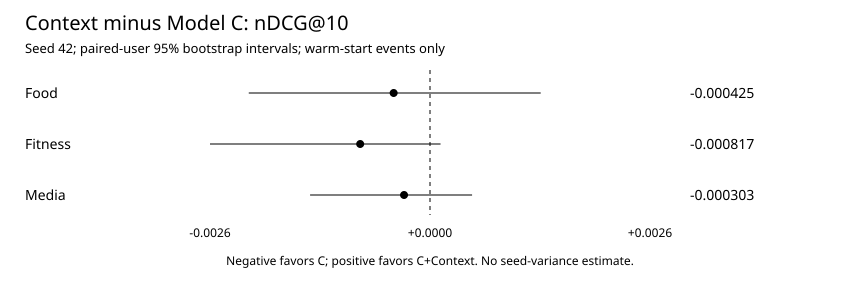
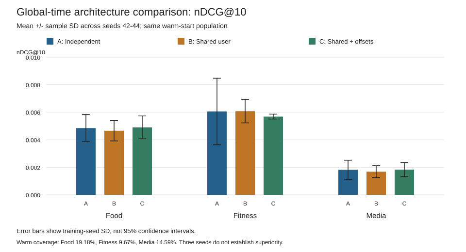
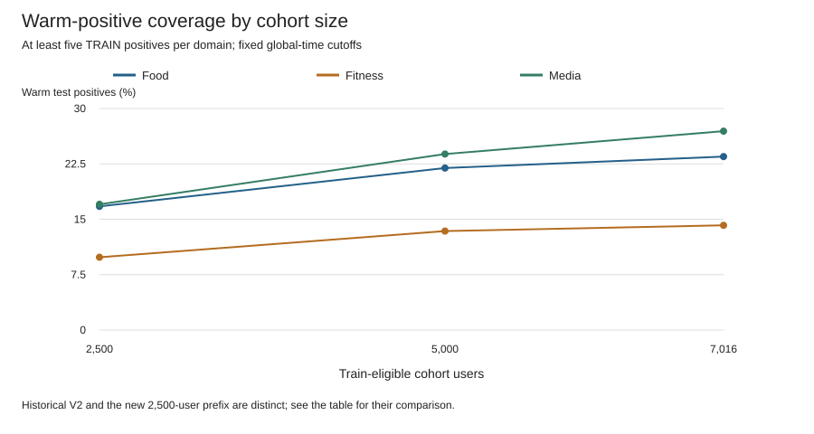
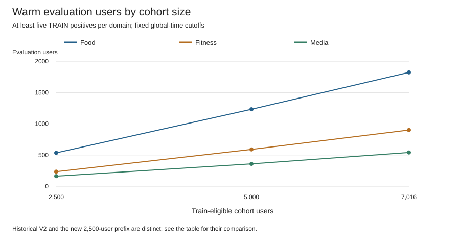

# ContextFit: Final Study

This front section is the thesis-facing synthesis of the frozen study. Exact machine-readable results remain in the linked artifacts; the detailed experiment records below are retained for provenance and are not a second protocol.

## 1. Research Questions

The primary question is whether shared-user learning improves recommendation when users interact with multiple Amazon product categories under a leakage-safe global-time protocol. Follow-up analyses ask whether any sharing effect is stable across domains, item-support levels, user-history groups, and a predeclared sparse-target/rich-auxiliary subgroup; whether selective residual sharing improves over a fixed-capacity control; and whether TRAIN-only relatedness diagnostics justify further transfer modeling.

## 2. Dataset and Protocol

The frozen primary benchmark uses 7,016 Amazon Reviews 2023 reviewers and three product-preference proxies: Grocery & Gourmet Food (Food), Sports & Outdoors (Fitness), and Movies & TV (Media). Positive means rating >= 4. Eligibility requires at least five TRAIN positives in each domain before the global training cutoff, `2019-09-29T04:42:29.728Z`. Mappings and item support are train-only. Ranking is over warm items with the frozen evaluation population and K=10 metrics. The expanded seed-42 model fits used Balanced sampling, four negatives per positive, batch size 512, Adam at 0.001, 12,486 optimizer steps, and ten predeclared validation checkpoints. Checkpoint selection uses macro validation nDCG@10, earliest tie. Test scoring followed checkpoint freeze.

This expanded confirmatory benchmark is distinct from historical V2: cohort eligibility, cohort size, item vocabulary, sampler implementation, and training budget differ. Their metrics are never pooled. The complete protocol/source fingerprints are in `results/final_study/expanded7016/` and `results/final_study/selective_transfer/`.

## 3. Baselines

Most Popular is a training-only reference. Model A is independent NeuMF per domain; B shares user representations with domain-specific item tables; C adds domain-specific user offsets. D_FIXED combines private representations with a fixed 0.5 shared residual. D has the same structure but learns one scalar gate per domain. D is a project selective-sharing baseline, not SyNCRec.

## 4. Architecture Experiments

Historical V2 three-seed macro nDCG@10 was A `0.004239715 ± 0.000872445`, B `0.004139369 ± 0.000316695`, and C `0.004138107 ± 0.000289442`. This did not establish a stable overall sharing advantage. In the separate expanded seed-42 study, A/B/C and D/D_FIXED are reported together only within that matched protocol. D's macro nDCG@10 is `0.001958331`, below D_FIXED `0.001994275`; D also fails the predeclared Food retention and learned-gate criteria. The canonical full result table (P@10, R@10, nDCG@10, selected step, parameter count, runtime, and peak RSS) is [`final_results_seed42.csv`](results/final_study/final_results_seed42.csv).

## 5. Coverage and Cold Start

For historical V2, warm-item test coverage was Food `19.18%` (1,741/9,076), Fitness `9.67%` (523/5,406), and Media `14.59%` (554/3,798). The expanded 7,016 train-eligible cohort reached Food `23.49%` (5,494/23,392), Fitness `14.18%` (1,401/9,880), and Media `26.93%` (1,363/5,061). Coverage improves with the larger eligible population, but many test targets remain cold under the global cutoff. See [`coverage_robustness_audit.json`](results/final_study/coverage_robustness_audit.json) and its derived tables.

## 6. Selective Transfer Feasibility

D and D_FIXED both completed the same seed-42 12,486-step fit and selected step 2,497 on validation. Their full test and paired-user results, gate diagnostics, Media Recall@100/nDCG@100, and the literal predeclared criteria are retained in [`selective_transfer/`](results/final_study/selective_transfer/) and the detailed record below. D exceeded B on macro nDCG but did not exceed D_FIXED, did not retain the Food benefit, and did not meet the joint replication rule. Decision: do not replicate scalar selective gating.

## 7. Gradient Diagnostic

A no-update D_FIXED diagnostic measured domain-specific gradients on shared parameters using TRAIN batches only. Mean combined cosine similarities were Food–Fitness `-0.002691`, Food–Media `-0.000038`, and Fitness–Media `+0.000117`; no pair showed cosine below `-0.1`, and gradient magnitudes were broadly similar. Strong gradient conflict or dominant-domain magnitude imbalance was not established. This is descriptive evidence, not a causal account of the ranking results.

## 8. Transferability Analysis

Across the primary trio, TRAIN activity Spearman correlations were Food–Fitness `0.1440`, Food–Media `0.1390`, and Fitness–Media `0.0981`. Every cross-domain chronological transition lift was below one. Frozen independent-model linear CKA was low (GMF `0.0021–0.0025`, MLP `0.0004–0.0038`); cross-domain neighborhoods were near random overlap and within-domain pairwise similarity structures were nearly uncorrelated. These separate diagnostics do not form a transferability score and do not measure ranking quality. Exact values and definitions are in [`transferability_seed42.json`](results/final_study/transferability_seed42.json).

## 9. Secondary Benchmark Screens

Two TRAIN-only screens met shared-user minimum counts but failed the predeclared requirement that both cross-domain transition lifts exceed one: Movies–CDs had lifts `0.5239` and `0.5283` among 38,142 eligible users; Sports–Health had `0.7648` and `0.7612` among 48,561. No new pair was selected and no model was trained. The retained screen definitions and raw summaries are in [`secondary_benchmark_screening_plan.json`](results/final_study/secondary_benchmark_screening_plan.json).

## 10. Discussion

The evidence is consistent with a limited conclusion: sharing users did not reliably help across these three categories under the tested protocol, and the TRAIN-only relatedness diagnostics were weak. The fixed private/shared residual control performed at least as well as learned scalar gates in this seed-42 feasibility. This benchmark therefore motivates caution about assuming cross-category preference transfer, rather than establishing that cross-domain recommendation generally fails.

## 11. Threats to Validity

Amazon categories are product-rating proxies, not direct behavioral domains. Global-time evaluation has substantial item cold-start and sparse warm support, especially in Fitness. Expanded A/B/C/D/D_FIXED results use one training seed; paired user-bootstrap intervals quantify within-fit uncertainty and do not substitute for seed replication. Media has a verified zero Top-10 retrieval result for all expanded seed-42 models, though D/D_FIXED have supplementary K=100 scores. CKA, neighborhood overlap, transitions, and gradient cosines are descriptive and noncausal. The secondary screens used a predeclared structural filter, not recommendation evaluation.

## 12. Final Conclusions

The project preserves a rigorous negative-transfer result for this specific data and protocol. Naïve global sharing has no reliable demonstrated advantage; the learned scalar gate does not add value beyond its fixed-capacity control; cross-domain temporal and representation relatedness are weak; and the screened secondary pairs do not pass the structural gate. Model development and category search are frozen. No claim is made that every transfer method or domain pairing will fail.

### Thesis Figures

Five self-contained SVGs are retained under `results/final_study/figures/`: `contextfit_protocol.svg` (study path and test-freeze boundary), `expanded_seed42_ndcg.svg` (six rows across three domains and macro at K=10), `warm_coverage_scaling.svg` (historical V2 distinguished from train-eligible prefixes), `cold_start_coverage.svg` (warm/cold test-item share for the expanded cohort), and `transferability_diagnostics.svg` (separate relatedness measures and secondary screen outcomes). No figure introduces a new metric or merges protocols.

## Research Code Organization

For the final expanded Amazon path, cohort eligibility and support analysis are in `coverage_robustness.py` and the frozen cohort construction records; canonical train-only data preparation is in `multidomain_data.py`; deterministic future memory-safe sampling and the final fit/provenance path are in `training.py`; model definitions A/B/C/D/D_FIXED are in `multidomain_model.py`; checkpoint and final-study evaluation/paired analyses are in `final_study.py` plus the frozen experiment runners; transferability diagnostics are captured by `transferability_seed42.json`. `architecture_control.py`, `architecture_replication.py`, `coverage_completion.py`, `coverage_tail_verification.py`, `final_study_report.py`, and older MovieLens/V1/V2 runners remain for historical reproducibility or frozen analysis; they are not all part of one active production pipeline. Raw data and large checkpoints are local and ignored.

## Detailed Frozen Experiment Records

The records below are preserved chronologically for provenance. Some early entries describe a study as pending because they were written before later authorized phases completed; use the front-section synthesis and latest dated/final phase records for current project status. Earlier records are not edited to make their historical timestamps appear contemporaneous with later work.

This phase studies offline Amazon product preferences. It does not change or deploy the live application's recommendation logic. The approved compute scope is **one seed first, then a report before multi-hour replication**.

## Existing work and reuse

The MovieLens baseline/context/adaptive experiments, Amazon V1 A/B/C comparisons, three- and six-seed studies, balancing diagnostics, checkpoint-selection study, V2 cohort, and V2 C pilot remain frozen. Their result files have not been regenerated.

- `multidomain_data.py`: train-only mappings, warm coverage, deterministic negatives and balanced fixed-step sampling.
- `multidomain_model.py`: independent NeuMF (A), shared users (B), shared users plus domain offsets (C).
- `multidomain_experiment.py`: architecture settings and validation-ranking checkpoint selection.
- `data.py` and `foundation.cjs`: negative sampling and reference metric checks.
- `amazon_data.py`: fingerprints and exclusive result creation.
- `adaptive.py`: a future reuse point for user-only replay; no Amazon online update is claimed here.

The historical runner also scores its BCE-selected checkpoint on test. The new pilot uses a small separate runner so both validation-selected models are frozen before either test evaluation. Existing runners and models are unchanged.

## Data and coverage

The existing V2 cohort contains 2,500 genuine shared reviewers and 121,864 ratings of at least 4. Grocery & Gourmet Food, Sports & Outdoors, and Movies & TV represent Food, Fitness, and Media **product-preference proxies**. They do not measure meals, workouts, or streaming behavior.

Cohort eligibility requires at least five full-history positives per domain, followed by deterministic reviewer hashing. This does not use test model performance, but it is a retrospective, future-activity-conditioned population. It is not a prospectively sampled cohort.

Global 70%/15%/15% timestamp cutoffs, with ties kept together:

- Train through `2019-09-29T04:42:29.728000+00:00`.
- Validation through `2021-04-05T22:30:28.490000+00:00`.
- Test after the second cutoff.

| Proxy | Train items | Train positives | Validation total / warm | Test total / warm | Test warm users |
|---|---:|---:|---:|---:|---:|
| Food | 16,503 | 25,552 | 8,914 / 2,348 | 9,076 / 1,741 | 751 |
| Fitness | 17,072 | 22,069 | 5,033 / 858 | 5,406 / 523 | 351 |
| Media | 25,546 | 37,683 | 4,333 / 993 | 3,798 / 554 | 254 |

There are 2,225 users with training history in all three domains, but only 45 with warm test events in all three. Test coverage is about 19.2%, 9.7%, and 14.6%, respectively. A warm user here must have training history in the target domain, keeping the eventual independent-model comparison on the same population. `protocol.json` separates cold-user/warm-item, warm-user/cold-item, and cold-user/cold-item exclusions. No cold items receive invented scores.

This split removes cross-user calendar-time leakage but loses substantial warm coverage relative to the earlier per-user split. It supports a limited warm-start feasibility study, not a claim of broad recommendation coverage. No V3 cohort was created.

## Controlled context pilot

The pilot compares Most Popular, C, and C+Context. A and B are not rerun in this compute stage, so it cannot establish sharing-versus-independent effects under the new protocol.

C+Context adds only 640 trainable weights. A 20-value vector contains the domain proportions of the five previous timestamp groups, latest first, plus a five-way time-gap bucket. Gap boundaries are one hour, one day, one week, and 30 days. Missing history is zero. Tied events are observed together; none sees a peer from its own timestamp.

A zero-initialized linear projection shifts the GMF and MLP user vectors. All original weights and initial predictions match C. This is a small ordered-history context model, not SyNCRec, a Transformer, or a learned item-sequence encoder.

Both models use seed 42, 16-dimensional embeddings, MLP layers 32/16, domain dimension 4, Adam at 0.001, batch size 512, four sampled negatives, and 3,200 balanced optimizer steps. They receive identical sampled examples, order, and 1,638,400 total draws. Ten validation windows occur every 320 steps. Highest macro validation nDCG@10 wins; exact ties keep the earliest checkpoint. Test results never select architecture or checkpoints.

Evaluation ranks the complete target-domain training catalog before revealing each timestamp group's positives. Previously observed positives are excluded. Earlier validation/test events may supply history and context after they occur, but no model parameters update during this static pilot. Metrics average queries within user, users within domain, then domains without weighting. Most Popular uses training counts only. This next-event protocol is **not directly comparable** to the old aggregate-held-out-target protocol.

The query time and requested domain are known. This does not predict whether an interaction will occur or which domain the user will choose. Context bundles ordered domains and time gaps; a positive result alone would not isolate which of those features helped.

In this cohort every evaluated timestamp group has one warm target. Consequently P@10 equals R@10 divided by ten. Both are reported for consistency, but they are not independent evidence of improvement.

Uncertainty uses 2,000 paired user-bootstrap draws for context minus C. These intervals condition on one trained seed. Seed SD is unavailable, not zero. Per-domain intervals are descriptive; they are not multiplicity-adjusted significance claims.

## Research questions and current status

| Question | Hypothesis and planned comparison | Status in this stage |
|---|---|---|
| RQ1: sharing | B/C improve P@10, R@10, nDCG@10 versus A | Historical V1 results are mixed; new global-protocol A/B comparison pending |
| RQ2: context | C+Context improves ranking versus C | Completed seed 42: lower point estimates in all domains; all paired nDCG intervals include zero |
| RQ3: negative transfer | Effects differ by source/target | Cannot infer a source-target matrix from aggregate sharing; pending controlled ablation or replay |
| RQ4: adaptation | User-only updates improve later predictions | Amazon immediate predict-then-update replay pending; static contextual history is not parameter adaptation |
| RQ5: cross-domain adaptation | A source-domain update helps another domain | Source-isolated user-update replay and paired target-user intervals pending |
| RQ6: diversity | Metadata-aware reranking increases variety with limited relevance loss | Blocked: prepared data has no usable within-domain categories or similarity metadata |

Historical six-seed V1 Balanced C minus A mean nDCG deltas were Food +0.001716, Fitness -0.006132, Media -0.000724, macro -0.001713. These are descriptive means under the old protocol, not significance tests or new pilot results. Model performance does not justify assuming that sharing always helps.

## Pilot results

These are single-seed point estimates, not mean +/- seed SD. The warm count is the evaluated positive-event count; the denominator includes all test positives in that domain. Macro metrics average the three domain means, not all pooled events.

| Model | Proxy | P@10 | R@10 | nDCG@10 | Warm / total test positives |
|---|---|---:|---:|---:|---:|
| Most Popular | Food | 0.000852 | 0.008524 | 0.004625 | 1,741 / 9,076 |
| Most Popular | Fitness | 0.000736 | 0.007360 | 0.004828 | 523 / 5,406 |
| Most Popular | Media | 0.000394 | 0.003937 | 0.001402 | 554 / 3,798 |
| Most Popular | Macro | 0.000661 | 0.006607 | 0.003618 | 2,818 / 18,280 |
| C | Food | 0.001360 | 0.013597 | 0.005345 | 1,741 / 9,076 |
| C | Fitness | 0.001021 | 0.010209 | 0.005739 | 523 / 5,406 |
| C | Media | 0.000525 | 0.005249 | 0.002163 | 554 / 3,798 |
| C | Macro | 0.000969 | 0.009685 | 0.004416 | 2,818 / 18,280 |
| C+Context | Food | 0.001204 | 0.012040 | 0.004920 | 1,741 / 9,076 |
| C+Context | Fitness | 0.000736 | 0.007360 | 0.004922 | 523 / 5,406 |
| C+Context | Media | 0.000443 | 0.004429 | 0.001860 | 554 / 3,798 |
| C+Context | Macro | 0.000794 | 0.007943 | 0.003901 | 2,818 / 18,280 |

Paired user-bootstrap nDCG@10 differences, C+Context minus C:

| Proxy | Mean delta | 95% interval | Evaluated users | Warm / total positives |
|---|---:|---|---:|---:|
| Food | -0.000425 | [-0.002120, +0.001295] | 751 | 1,741 / 9,076 |
| Fitness | -0.000817 | [-0.002573, +0.000123] | 351 | 523 / 5,406 |
| Media | -0.000303 | [-0.001402, +0.000492] | 254 | 554 / 3,798 |



C has the highest observed metrics among the three evaluated models. C+Context has lower point estimates than C in every domain, despite slightly higher selected validation macro nDCG (0.005920 versus 0.005810). All nDCG intervals include zero. This is **no evidence of an improvement from this context extension**, not proof of equivalence or general harm. A/B controls, other seeds, and much broader coverage are still missing. No settings were changed after seeing test results.

Both models selected step 640 and completed the same 3,200-step budget. Sampling hashes and per-domain draw counts match exactly. C has 2,207,741 parameters; C+Context has 2,208,381. All 640 added weights are nonzero at the selected checkpoint, with norm 2.280581; the context input is connected and trained. The complete pilot took 706.8 seconds (11.8 minutes): C training/validation 332.4 seconds, C+Context 344.5 seconds, and test scoring 1.1/11.2/11.9 seconds for Most Popular/C/C+Context. Peak process RSS was 3.46 GB; the existing negative-candidate pools are a likely contributor, but memory was not profiled by allocation.

The pilot is computationally feasible, but its low coverage and weak absolute ranking metrics need to stay visible. Two more seeds for the same pair would take roughly another 24 minutes at this rate, excluding interruptions. They have **not** been launched. The broader study also needs A/B controls and an independently specified immediate adaptive replay; this document is not a claim that the full final study is complete.

## Paper audit and decisions

- [Impatient Bandits](https://arxiv.org/abs/2307.09943), [official implementation](https://github.com/spotify-research/impatient-bandits): Bayesian use of progressively observed rewards and exploration motivates the adaptation question. Amazon's ratings-only rows have no recommendation exposures or partial/final reward trajectories. No delayed reward was fabricated; only immediate replay would be defensible here.
- [SyNCRec / Pacer and Runner](https://arxiv.org/abs/2407.11245), [official implementation](https://github.com/cpark88/SyNCRec): motivates independent/shared sequential controls and negative-transfer analysis. The supplied implementation uses CUDA-specific placement, five-domain assumptions, transformer/expert components, and a four-process training command. A faithful three-domain CPU adaptation is outside this pilot budget. C+Context is explicitly a project model, not a reproduction.
- [TimeMCL](https://arxiv.org/abs/2506.05515), [official implementation](https://github.com/Victorletzelter/timeMCL): motivates asking whether multiple outputs collapse. It is a probabilistic forecasting method, not an item-ranking method. No WTA model is implemented.
- [Recommenders](https://github.com/recommenders-team/recommenders): data/model/evaluation workflow reference, not an imported dependency.
- [CRSLab](https://arxiv.org/abs/2101.00939): modular interaction/evaluation reference; there is no conversational recommender implementation.

### WTA design note

A possible ranking analogue would use heads `s_h(u, history, item)` and minimize `min_h L_rank(s_h, positive, negatives)`. Only the winning head would update on that example. This does not establish the trajectory-distribution interpretation of TimeMCL. Head collapse, untrained losing heads, score calibration, and the rule for combining heads into one ranked list remain unresolved. It is not justified as a drop-in diversity baseline.

The prepared Amazon inputs contain only a broad domain/category and `parent_asin`, not product titles or within-domain category hierarchies. Parent IDs already deduplicate product families. Unique IDs are not evidence of semantic diversity. A controlled diversity experiment needs a documented official metadata join first; no substitute categories were invented.

## Reproduction and artifacts

Run from `research/` using the existing environment:

```sh
.venv/bin/python -B -m unittest discover -s . -p 'test_*.py' -v
.venv/bin/python -B final_study.py --train
.venv/bin/python -B final_study_report.py
```

The training command refuses an existing final-study protocol rather than silently overwriting or repeating test evaluation. Results belong in `research/results/final_study/`; checkpoints stay in ignored `research/runs/`. No raw data or checkpoint is intended for Git. No stage, commit, or push is part of this pass.

New files:

- `multidomain_context.py`: causal history features and the small context extension.
- `final_study.py`: isolated protocol, matched training, test-once evaluation and paired uncertainty.
- `final_study_report.py`: CSV tables and an SVG figure from saved results, without model execution.
- `test_final_study.py`: nine focused tests for leakage, contexts, negatives, initialization, metrics and the training budget.
- This document and `results/final_study/{protocol.json,pilot_seed42.json,metrics.csv,coverage.csv,context_deltas.csv,context_delta.svg}`.

Validation: 78 research tests passed, including the original 69. Syntax checks passed for 36 Python files, and all 22 result JSON files parsed. The exported CSV metrics match the saved JSON, per-user means and coverage recompute correctly, protocol/source hashes match, and the SVG structure is valid. The exporter also passed a temporary CSV/SVG smoke check. `git diff --check` passed; the new research files have no trailing whitespace. App regressions were not rerun because no application or shared code changed. All 253 protected application/historical-result files matched the pre-pass aggregate SHA-256 `c95b17bdf3f2baec20991daaadb742d4972d4aa3cffc794ca5beb73572fb088b`.

## Global-Time Architecture Control - Seed 42

This is a separate experiment answering whether shared learning outperforms independent learning under the frozen global-time protocol. Nothing in the preceding context pilot was changed or tuned. A and B are new training runs; C is **reused from frozen final-study pilot; not re-evaluated** on test. Most Popular is the same frozen reference. C+Context remains background only: context feasibility result, no demonstrated improvement.

### Control and provenance

The existing A/B/C definitions are unchanged. A has independent domain networks, B shares user embeddings and branch layers with disjoint item tables, and C additionally has domain-specific user offsets. Parameter counts are allowed to differ naturally. Equal steps and sampled examples do not mean equal FLOPs or model capacity.

All three use the same V2 cohort, global cutoffs, ratings >= 4, train-only mappings, warm filtering, full-catalog evaluation, Balanced sampler, batch size 512, Adam at 0.001, four negatives, and 3,200 optimizer steps. Validation occurs every 320 steps. The checkpoint maximizes unweighted macro validation nDCG@10, with the earliest step winning ties. Each architecture receives 1,638,400 sampled examples.

C reuse is supported by matching the frozen manifest hash, prepared-file hashes, splitter/evaluator source hashes, configuration, checkpoint architecture, mappings, cutoffs and complete coverage. Its saved checkpoint also reproduces the selected step-640 validation metrics exactly. The history verifies the maximum-validation/earliest-tie rule and complete training schedule. The frozen protocol did not contain a standalone split-hash field; the control records a reconstructed hash over splits, cutoffs, mappings and domain memberships: `c151de48df83723a510d55ab1586162aa88df079eed3e47a11a969bee2f74e1c`. This is not presented as a previously stored checksum.

The new runner imports the frozen pilot's training and evaluation functions. All architecture selectors are fixed before A/B test scoring. It refuses existing output paths and stops on mismatched sampling or evaluation populations. The context model, adaptive replay, transfer matrix and diversity experiment are not run.

### Paired analysis

Domain comparisons reuse the pilot's 2,000-draw paired-user bootstrap, seed 42. Macro intervals resample the union of reviewers jointly, preserve each reviewer's domain memberships, recompute the three domain means, then take their unweighted average. This preserves correlation for reviewers present in multiple domains; it does not restrict evaluation to the 45 reviewers warm in all three domains. Resamples missing a domain are rejected.

Intervals describe uncertainty conditional on this seed and the observed warm population. They are not corrected for multiple comparisons and do not estimate training-seed variability. Positive or negative means alone are not evidence of reliable transfer.

### Architecture-control results

Metrics below are fractions, not percentages. Macro is the unweighted mean of the three domain metrics. Exact values and per-user measurements are in the JSON; tables are rounded to nine decimals.

| Model | Domain | P@10 | R@10 | nDCG@10 |
| --- | --- | ---: | ---: | ---: |
| Most Popular (frozen) | Food | 0.000852356 | 0.008523556 | 0.004624959 |
| Most Popular (frozen) | Fitness | 0.000735992 | 0.007359924 | 0.004828104 |
| Most Popular (frozen) | Media | 0.000393701 | 0.003937008 | 0.001402391 |
| Most Popular (frozen) | Macro | 0.000660683 | 0.006606829 | 0.003618484 |
| A | Food | 0.000871118 | 0.008711185 | 0.003799905 |
| A | Fitness | 0.001020893 | 0.010208927 | 0.005760953 |
| A | Media | 0.000574147 | 0.005741470 | 0.002584112 |
| A | Macro | 0.000822053 | 0.008220527 | 0.004048323 |
| B | Food | 0.001106360 | 0.011063604 | 0.004656196 |
| B | Fitness | 0.001305793 | 0.013057930 | 0.007054726 |
| B | Media | 0.000393701 | 0.003937008 | 0.001695577 |
| B | Macro | 0.000935285 | 0.009352847 | 0.004468833 |
| C (frozen) | Food | 0.001359726 | 0.013597262 | 0.005345289 |
| C (frozen) | Fitness | 0.001020893 | 0.010208927 | 0.005738631 |
| C (frozen) | Media | 0.000524934 | 0.005249344 | 0.002163041 |
| C (frozen) | Macro | 0.000968518 | 0.009685178 | 0.004415653 |

The frozen C+Context reference has Food/Fitness/Media/macro nDCG of 0.004920185 / 0.004922121 / 0.001859619 / 0.003900642. **Context feasibility result - no demonstrated improvement.** It is not part of architecture selection, and it was not retrained or re-evaluated.

| Model | Parameters | Selected step | Best validation macro nDCG | Train + validation seconds | Test seconds | Peak training-worker RSS |
| --- | ---: | ---: | ---: | ---: | ---: | ---: |
| A | 2,123,571 | 640 | 0.005577723 | 333.613 | 10.899 | 3.252 GB |
| B | 1,972,157 | 320 | 0.005402896 | 317.564 | 9.984 | 3.238 GB |
| C (historical run) | 2,207,741 | 640 | 0.005810169 | 332.414 | 11.193 | Not recorded separately |

All completed the 3,200-step budget; selected steps are not early stopping points. C's times are historical, not new execution. The frozen pilot's 3.458 GB peak covered the combined C/context process, so it cannot be assigned to C alone. A/B peaks come from isolated training workers, including their data preparation. GB uses decimal units. The new control took 712.088 seconds in total, including provenance validation and paired analysis. The parent process peaked at 0.571 GB; simultaneous combined memory was not measured.

All three training streams have SHA-256 `bf6e82a18e1f3383a4c44d1b4f0caec016cfb437a14c41733b1f08309a18d4c0`. Each used 546,140 Food, 546,130 Fitness and 546,130 Media draws. There were no changed hyperparameters or post-test checkpoint choices.

### Coverage and paired differences

| Domain | Warm test positives | Total test positives | Warm coverage | Evaluation users |
| --- | ---: | ---: | ---: | ---: |
| Food | 1,741 | 9,076 | 19.18% | 751 |
| Fitness | 523 | 5,406 | 9.67% | 351 |
| Media | 554 | 3,798 | 14.59% | 254 |

Counts and exact evaluation-user sets match across A/B/C. No intersection or dropped users was needed. Macro intervals use 1,004 distinct reviewer clusters. Only 45 reviewers are warm in all three domains. The results concern warm users/items, not the majority of held-out events that could not be scored.

| Comparison | Domain | Mean paired nDCG delta | 95% paired bootstrap CI |
| --- | --- | ---: | --- |
| B - A | Food | +0.000856291 | [-0.000952240, +0.003139411] |
| B - A | Fitness | +0.001293773 | [0.000000000, +0.003310229] |
| B - A | Media | -0.000888535 | [-0.002142781, 0.000000000] |
| B - A | Macro | +0.000420509 | [-0.000487299, +0.001467622] |
| C - A | Food | +0.001545384 | [-0.000284337, +0.003382619] |
| C - A | Fitness | -0.000022322 | [-0.000123375, +0.000056410] |
| C - A | Media | -0.000421072 | [-0.001115070, 0.000000000] |
| C - A | Macro | +0.000367330 | [-0.000236682, +0.001035022] |
| C - B | Food | +0.000689093 | [-0.001798721, +0.002852557] |
| C - B | Fitness | -0.001316095 | [-0.003335311, -0.000041125] |
| C - B | Media | +0.000467464 | [0.000000000, +0.001402391] |
| C - B | Macro | -0.000053179 | [-0.001090620, +0.000915440] |

Relative to A, B has positive Food/Fitness directions and a negative Media direction. C has a positive Food direction, a near-zero negative Fitness direction and a negative Media direction. **All six sharing-versus-independent intervals include zero: every direction is uncertain.** C - B in Fitness excludes zero in this conditional analysis, but one seed and unadjusted comparisons do not establish a general difference.

### Decision after seed 42

**REPLICATE A/B/C TO SEEDS 43-44.** This is a recommendation, not authorization to launch them. No additional seeds have run.

The matched control now answers the architecture question without changing the sampling or split. Both sharing models have higher macro point estimates than A, but the intervals are wide and Media goes in the opposite direction. Replication is worthwhile to determine whether these domain tradeoffs repeat across training seeds, including possible negative transfer. It is not justified to claim that sharing already improves ranking.

B is the slightly more promising candidate on the primary macro nDCG point estimate and has fewer parameters, but its difference from C is small and uncertain. C has higher Food and Media nDCG than B, and higher macro precision/recall. There is no reliable overall winner; retain A/B/C for the proposed replication rather than dropping a control based on test results. Low warm coverage remains a limitation regardless of replication. The control addresses architecture sharing and a provisional negative-transfer screen; it does not establish sequential cross-domain learning or cold-start performance.

### Architecture-control artifacts and checks

Run from `research/`:

```sh
.venv/bin/python -B -m unittest test_architecture_control -v
.venv/bin/python -B -m unittest discover -s . -p 'test_*.py' -v
.venv/bin/python -B architecture_control.py --train
```

The last command has already completed and now refuses the existing outputs. Do not delete frozen artifacts to rerun it. Training checkpoints and worker logs are in ignored `research/runs/architecture-control-20261012T190706671463Z/`.

- `architecture_control.py`: reuses the frozen training/evaluation path, verifies provenance, isolates A/B training and exports paired comparisons.
- `test_architecture_control.py`: six focused tests for matched coverage, macro weighting, reviewer-cluster resampling, cautious direction labels, comparison signs and identical A/B/C sampling budgets.
- `results/final_study/architecture_control_protocol_seed42.json`: pre-run configuration, source/input hashes and C reuse checks.
- `results/final_study/architecture_control_seed42.json`: measurements, per-user metrics, coverage and pairwise uncertainty.
- `results/final_study/architecture_control_seed42.csv`: model/domain metrics and coverage, including frozen references.
- `results/final_study/architecture_control_seed42_deltas.csv`: all P/R/nDCG pairwise effects and intervals.

The application, historical research artifacts and frozen context pilot were not changed. This section was appended separately so the earlier feasibility record remains intact. Nothing was staged, committed or pushed.

Final validation: 84/84 research tests passed, including the six architecture-control tests; 38 Python files passed syntax checks. Both new JSON files parsed. All 20 metrics rows and 36 pairwise CSV rows matched the JSON, macro arithmetic and per-user means. Paired bootstrap results reproduced exactly. Sampling hashes, checkpoint selection, coverage and registered source hashes passed verification. All 304 protected files matched the pre-control aggregate SHA-256 `b2af03fd4a93593e06c87d2f3d1a43b3979ad72076a3322b41b0811e469923ab`. `git diff --check` passed; application tests were not rerun because this pass did not modify application code.

## Global-Time Architecture Replication - Seeds 42-44

This continuation adds six fresh fits: A/B/C at seeds 43 and 44. Seed 42 is read from its frozen architecture-control artifact, including its documented reuse of C. The context pilot remains unchanged and is not included in the architecture comparison. No adaptive replay, source-target matrix, diversity experiment or additional seed is part of this run.

### Replication control

`architecture_replication.py` calls the existing frozen `train_model` and evaluator. The only run-configuration changes are the declared seed and existing architecture variant. The V2 cohort, global cutoffs, train-only mappings, Balanced sampler, four negatives, Adam learning rate 0.001, batch 512, 3,200 steps, ten validation checkpoints and maximum-macro-nDCG/earliest-tie selection remain fixed. Every fit receives 1,638,400 examples. Parameter counts remain A 2,123,571; B 1,972,157; C 2,207,741. Equal optimizer steps are not a claim of equal compute or capacity.

Before training, the runner verifies frozen input, source, configuration, split and candidate-query hashes. It records a new replication protocol and a protected-file snapshot. Each fit runs in its own process to measure training-worker peak RSS. All six validation-selected checkpoints are fixed before any new test scoring. Training stream hashes must match across architectures within a seed; different declared seeds must produce different hashes. Coverage and exact evaluation-user sets must match the frozen control before results are accepted.

### Across-seed and within-fit uncertainty

For every domain and the unweighted domain macro, the main table reports mean and sample SD across seeds 42, 43 and 44 (`ddof=1`). Pairwise architecture differences are calculated inside each seed first, then summarized with mean, sample SD and positive/negative/zero seed counts. Three fits are the replication sample, not hundreds of independent user observations.

Each seed also retains its own paired-user nDCG intervals using the unchanged 2,000-draw bootstrap and bootstrap RNG seed 42. The macro bootstrap preserves reviewer overlap across domains. Evaluation users are never pooled across fitted seeds. These intervals measure conditional within-fit uncertainty and do not replace training-seed variability. No multiplicity correction or general-superiority claim is implied.

### Interruption recovery and checkpoint freeze

The original coordinator and final training worker survived the interruption. Seed43/A completed normally; no fit was resumed from weights or restarted. Filesystem inspection found five complete checkpoint/manifests and the final seed44/C worker still training. No seed43/44 test-result files existed. The coordinator alone was paused while the final worker finished normally. All six manifests and saved checkpoint configurations/mappings were verified, and the freeze CSV below was written before the coordinator was released for its planned test scoring. No completed fit was repeated and no partial artifacts needed quarantine.

| Seed | Model | Selected step | Best validation macro nDCG | Train + validation seconds | Test seconds | Peak training RSS (GB) | Status |
| --- | --- | ---: | ---: | ---: | ---: | ---: | --- |
| 43 | A | 640 | 0.005303620 | 337.410 | 10.904 | 3.260 | COMPLETE |
| 43 | B | 320 | 0.005107978 | 316.148 | 9.986 | 3.323 | COMPLETE |
| 43 | C | 320 | 0.004933998 | 336.956 | 10.907 | 3.316 | COMPLETE |
| 44 | A | 3200 | 0.005297447 | 338.018 | 11.163 | 3.319 | COMPLETE |
| 44 | B | 320 | 0.005345006 | 324.007 | 10.126 | 3.225 | COMPLETE |
| 44 | C | 320 | 0.005109939 | 335.246 | 10.989 | 3.311 | COMPLETE |

Each row completed 3,200 optimizer steps, ten validation windows and 1,638,400 examples. The freeze CSV additionally records exact checkpoint/manifest hashes, full sampling hashes and pre-test timestamps. Test timings above were added to this report only after evaluation. GB uses decimal units.

- Seed 42 training stream SHA-256: `bf6e82a18e1f3383a4c44d1b4f0caec016cfb437a14c41733b1f08309a18d4c0`.
- Seed 43 training stream SHA-256: `23af50c37e20f27fb7552d7392de9d6662a14a6ea395cef0b165c1de88285df5`.
- Seed 44 training stream SHA-256: `16db1a5c2ee91449299981260642f79f47a9df5afd03927c1fad95224db365fe`.

Hashes match A/B/C within each seed and differ across seeds. The new coordinator reported 2169.265 elapsed seconds, including verification and the freeze pause. Summed training/validation time was 1987.785 seconds; test scoring totaled 64.075 seconds. Parent peak RSS was 0.535 GB, measured separately. No simultaneous combined peak was measured; elapsed coordinator time is not an uninterrupted training benchmark.

### Fresh test metrics

All values are fractions, not percentages. Nine decimal places are shown; JSON/CSV retain full precision.

| Seed | Model | Domain | P@10 | R@10 | nDCG@10 |
| --- | --- | --- | ---: | ---: | ---: |
| 43 | A | Food | 0.000932148 | 0.009321482 | 0.005000857 |
| 43 | A | Fitness | 0.000379867 | 0.003798670 | 0.003798670 |
| 43 | A | Media | 0.000524934 | 0.005249344 | 0.001637040 |
| 43 | A | Macro | 0.000612317 | 0.006123165 | 0.003478856 |
| 43 | B | Food | 0.000798992 | 0.007989924 | 0.003917909 |
| 43 | B | Fitness | 0.000902184 | 0.009021842 | 0.005485089 |
| 43 | B | Media | 0.000574147 | 0.005741470 | 0.002108633 |
| 43 | B | Macro | 0.000758441 | 0.007584412 | 0.003837210 |
| 43 | C | Food | 0.000798992 | 0.007989924 | 0.003943971 |
| 43 | C | Fitness | 0.000902184 | 0.009021842 | 0.005485089 |
| 43 | C | Media | 0.000574147 | 0.005741470 | 0.002085183 |
| 43 | C | Macro | 0.000758441 | 0.007584412 | 0.003838081 |
| 44 | A | Food | 0.001395494 | 0.013954938 | 0.005743913 |
| 44 | A | Fitness | 0.001614435 | 0.016144349 | 0.008603001 |
| 44 | A | Media | 0.000328084 | 0.003280840 | 0.001228985 |
| 44 | A | Macro | 0.001112671 | 0.011126709 | 0.005191966 |
| 44 | B | Food | 0.001075392 | 0.010753915 | 0.005396201 |
| 44 | B | Fitness | 0.000949668 | 0.009496676 | 0.005698006 |
| 44 | B | Media | 0.000393701 | 0.003937008 | 0.001241988 |
| 44 | B | Macro | 0.000806253 | 0.008062533 | 0.004112065 |
| 44 | C | Food | 0.001075392 | 0.010753915 | 0.005411430 |
| 44 | C | Fitness | 0.000949668 | 0.009496676 | 0.005828341 |
| 44 | C | Media | 0.000393701 | 0.003937008 | 0.001241988 |
| 44 | C | Macro | 0.000806253 | 0.008062533 | 0.004160586 |

### Three-seed means and sample SD

Mean +/- sample SD across seeds 42-44, not confidence intervals. Macro averages domains equally inside each seed.

| Model | Domain | P@10 mean +/- SD | R@10 mean +/- SD | nDCG@10 mean +/- SD |
| --- | --- | --- | --- | --- |
| A | Food | 0.001066253 +/- 0.000286759 | 0.010662535 +/- 0.002867587 | 0.004848225 +/- 0.000980951 |
| A | Fitness | 0.001005065 +/- 0.000617436 | 0.010050649 +/- 0.006174361 | 0.006054208 +/- 0.002415553 |
| A | Media | 0.000475722 +/- 0.000130204 | 0.004757218 +/- 0.001302043 | 0.001816712 +/- 0.000695201 |
| A | Macro | 0.000849013 +/- 0.000251264 | 0.008490134 +/- 0.002512644 | 0.004239715 +/- 0.000872445 |
| B | Food | 0.000993581 +/- 0.000169229 | 0.009935814 +/- 0.001692289 | 0.004656769 +/- 0.000739146 |
| B | Fitness | 0.001052548 +/- 0.000220598 | 0.010525483 +/- 0.002205977 | 0.006079274 +/- 0.000851448 |
| B | Media | 0.000453850 +/- 0.000104181 | 0.004538495 +/- 0.001041807 | 0.001682066 +/- 0.000433480 |
| B | Macro | 0.000833326 +/- 0.000091477 | 0.008333264 +/- 0.000914774 | 0.004139369 +/- 0.000316695 |
| C | Food | 0.001078037 +/- 0.000280376 | 0.010780367 +/- 0.002803763 | 0.004900230 +/- 0.000828804 |
| C | Fitness | 0.000957582 +/- 0.000059749 | 0.009575815 +/- 0.000597486 | 0.005684021 +/- 0.000178023 |
| C | Media | 0.000497594 +/- 0.000093278 | 0.004975941 +/- 0.000932782 | 0.001830070 +/- 0.000510780 |
| C | Macro | 0.000844404 +/- 0.000110112 | 0.008444041 +/- 0.001101120 | 0.004138107 +/- 0.000289442 |



Frozen Most Popular nDCG remains Food 0.004624959, Fitness 0.004828104, Media 0.001402391, macro 0.003618484. It was not recomputed and is seed-independent. The frozen context pilot remains separate: C macro 0.004415653 versus C+Context 0.003900642; no demonstrated context improvement.

### Paired architecture differences across seeds

These are paired within-seed differences before aggregation. Counts list positive / negative / zero seeds. Small nonzero values are not recoded as ties.

| Contrast | Domain | Metric | Seed 42 | Seed 43 | Seed 44 | Mean delta +/- sample SD | Signs (+/-/0) |
| --- | --- | --- | ---: | ---: | ---: | --- | --- |
| B-A | Food | precision@10 | +0.000235242 | -0.000133156 | -0.000320102 | -0.000072672 +/- 0.000282569 | 1/2/0 |
| B-A | Food | recall@10 | +0.002352419 | -0.001331558 | -0.003201023 | -0.000726721 +/- 0.002825695 | 1/2/0 |
| B-A | Food | ndcg@10 | +0.000856291 | -0.001082948 | -0.000347712 | -0.000191456 +/- 0.000979016 | 1/2/0 |
| B-A | Fitness | precision@10 | +0.000284900 | +0.000522317 | -0.000664767 | +0.000047483 +/- 0.000628146 | 2/1/0 |
| B-A | Fitness | recall@10 | +0.002849003 | +0.005223172 | -0.006647673 | +0.000474834 +/- 0.006281461 | 2/1/0 |
| B-A | Fitness | ndcg@10 | +0.001293773 | +0.001686419 | -0.002904995 | +0.000025065 +/- 0.002545091 | 2/1/0 |
| B-A | Media | precision@10 | -0.000180446 | +0.000049213 | +0.000065617 | -0.000021872 +/- 0.000137574 | 2/1/0 |
| B-A | Media | recall@10 | -0.001804462 | +0.000492126 | +0.000656168 | -0.000218723 +/- 0.001375738 | 2/1/0 |
| B-A | Media | ndcg@10 | -0.000888535 | +0.000471592 | +0.000013003 | -0.000134647 +/- 0.000691980 | 2/1/0 |
| B-A | Macro | precision@10 | +0.000113232 | +0.000146125 | -0.000306418 | -0.000015687 +/- 0.000252317 | 2/1/0 |
| B-A | Macro | recall@10 | +0.001132320 | +0.001461247 | -0.003064176 | -0.000156870 +/- 0.002523167 | 2/1/0 |
| B-A | Macro | ndcg@10 | +0.000420509 | +0.000358354 | -0.001079901 | -0.000100346 +/- 0.000848889 | 2/1/0 |
| C-A | Food | precision@10 | +0.000488608 | -0.000133156 | -0.000320102 | +0.000011783 +/- 0.000423389 | 1/2/0 |
| C-A | Food | recall@10 | +0.004886078 | -0.001331558 | -0.003201023 | +0.000117832 +/- 0.004233893 | 1/2/0 |
| C-A | Food | ndcg@10 | +0.001545384 | -0.001056886 | -0.000332483 | +0.000052005 +/- 0.001343065 | 1/2/0 |
| C-A | Fitness | precision@10 | +0.000000000 | +0.000522317 | -0.000664767 | -0.000047483 +/- 0.000594965 | 1/1/1 |
| C-A | Fitness | recall@10 | +0.000000000 | +0.005223172 | -0.006647673 | -0.000474834 +/- 0.005949651 | 1/1/1 |
| C-A | Fitness | ndcg@10 | -0.000022322 | +0.001686419 | -0.002774660 | -0.000370188 +/- 0.002250792 | 1/2/0 |
| C-A | Media | precision@10 | -0.000049213 | +0.000049213 | +0.000065617 | +0.000021872 +/- 0.000062105 | 2/1/0 |
| C-A | Media | recall@10 | -0.000492126 | +0.000492126 | +0.000656168 | +0.000218723 +/- 0.000621053 | 2/1/0 |
| C-A | Media | ndcg@10 | -0.000421072 | +0.000448143 | +0.000013003 | +0.000013358 +/- 0.000434607 | 2/1/0 |
| C-A | Macro | precision@10 | +0.000146465 | +0.000146125 | -0.000306418 | -0.000004609 +/- 0.000261374 | 2/1/0 |
| C-A | Macro | recall@10 | +0.001464651 | +0.001461247 | -0.003064176 | -0.000046093 +/- 0.002613737 | 2/1/0 |
| C-A | Macro | ndcg@10 | +0.000367330 | +0.000359225 | -0.001031380 | -0.000101608 +/- 0.000805216 | 2/1/0 |
| C-B | Food | precision@10 | +0.000253366 | +0.000000000 | +0.000000000 | +0.000084455 +/- 0.000146281 | 1/0/2 |
| C-B | Food | recall@10 | +0.002533659 | +0.000000000 | +0.000000000 | +0.000844553 +/- 0.001462809 | 1/0/2 |
| C-B | Food | ndcg@10 | +0.000689093 | +0.000026062 | +0.000015229 | +0.000243461 +/- 0.000385966 | 3/0/0 |
| C-B | Fitness | precision@10 | -0.000284900 | +0.000000000 | +0.000000000 | -0.000094967 +/- 0.000164487 | 0/1/2 |
| C-B | Fitness | recall@10 | -0.002849003 | +0.000000000 | +0.000000000 | -0.000949668 +/- 0.001644873 | 0/1/2 |
| C-B | Fitness | ndcg@10 | -0.001316095 | +0.000000000 | +0.000130335 | -0.000395253 +/- 0.000800130 | 1/1/1 |
| C-B | Media | precision@10 | +0.000131234 | +0.000000000 | +0.000000000 | +0.000043745 +/- 0.000075768 | 1/0/2 |
| C-B | Media | recall@10 | +0.001312336 | +0.000000000 | +0.000000000 | +0.000437445 +/- 0.000757678 | 1/0/2 |
| C-B | Media | ndcg@10 | +0.000467464 | -0.000023449 | +0.000000000 | +0.000148005 +/- 0.000276908 | 1/1/1 |
| C-B | Macro | precision@10 | +0.000033233 | +0.000000000 | +0.000000000 | +0.000011078 +/- 0.000019187 | 1/0/2 |
| C-B | Macro | recall@10 | +0.000332331 | +0.000000000 | +0.000000000 | +0.000110777 +/- 0.000191871 | 1/0/2 |
| C-B | Macro | ndcg@10 | -0.000053179 | +0.000000871 | +0.000048521 | -0.000001262 +/- 0.000050884 | 2/1/0 |

### Within-fit paired-user nDCG intervals

Each row is a separate fitted seed. Domain populations are Food 751, Fitness 351 and Media 254 users; macro uses 1,004 distinct reviewer clusters. No user populations were intersected or silently dropped because their exact sets match.

| Seed | Contrast | Domain | Paired mean delta | 95% bootstrap CI |
| --- | --- | --- | ---: | --- |
| 42 | B-A | Food | +0.000856291 | [-0.000952240, +0.003139411] |
| 42 | B-A | Fitness | +0.001293773 | [+0.000000000, +0.003310229] |
| 42 | B-A | Media | -0.000888535 | [-0.002142781, +0.000000000] |
| 42 | B-A | Macro | +0.000420509 | [-0.000487299, +0.001467622] |
| 42 | C-A | Food | +0.001545384 | [-0.000284337, +0.003382619] |
| 42 | C-A | Fitness | -0.000022322 | [-0.000123375, +0.000056410] |
| 42 | C-A | Media | -0.000421072 | [-0.001115070, +0.000000000] |
| 42 | C-A | Macro | +0.000367330 | [-0.000236682, +0.001035022] |
| 42 | C-B | Food | +0.000689093 | [-0.001798721, +0.002852557] |
| 42 | C-B | Fitness | -0.001316095 | [-0.003335311, -0.000041125] |
| 42 | C-B | Media | +0.000467464 | [+0.000000000, +0.001402391] |
| 42 | C-B | Macro | -0.000053179 | [-0.001090620, +0.000915440] |
| 43 | B-A | Food | -0.001082948 | [-0.003812059, +0.001137386] |
| 43 | B-A | Fitness | +0.001686419 | [+0.000000000, +0.004271598] |
| 43 | B-A | Media | +0.000471592 | [+0.000000000, +0.001181847] |
| 43 | B-A | Macro | +0.000358354 | [-0.000755490, +0.001428821] |
| 43 | C-A | Food | -0.001056886 | [-0.003816916, +0.001237693] |
| 43 | C-A | Fitness | +0.001686419 | [+0.000000000, +0.004271598] |
| 43 | C-A | Media | +0.000448143 | [+0.000000000, +0.001158397] |
| 43 | C-A | Macro | +0.000359225 | [-0.000737386, +0.001449994] |
| 43 | C-B | Food | +0.000026062 | [-0.000023172, +0.000104197] |
| 43 | C-B | Fitness | +0.000000000 | [+0.000000000, +0.000000000] |
| 43 | C-B | Media | -0.000023449 | [-0.000070348, +0.000000000] |
| 43 | C-B | Macro | +0.000000871 | [-0.000025359, +0.000031683] |
| 44 | B-A | Food | -0.000347712 | [-0.003499317, +0.002989653] |
| 44 | B-A | Fitness | -0.002904995 | [-0.008128763, +0.002057613] |
| 44 | B-A | Media | +0.000013003 | [-0.002752027, +0.003444908] |
| 44 | B-A | Macro | -0.001079901 | [-0.003390567, +0.001009888] |
| 44 | C-A | Food | -0.000332483 | [-0.003481020, +0.003000186] |
| 44 | C-A | Fitness | -0.002774660 | [-0.008087816, +0.002318284] |
| 44 | C-A | Media | +0.000013003 | [-0.002752027, +0.003444908] |
| 44 | C-A | Macro | -0.001031380 | [-0.003388342, +0.001092775] |
| 44 | C-B | Food | +0.000015229 | [+0.000000000, +0.000040610] |
| 44 | C-B | Fitness | +0.000130335 | [+0.000000000, +0.000325838] |
| 44 | C-B | Media | +0.000000000 | [+0.000000000, +0.000000000] |
| 44 | C-B | Macro | +0.000048521 | [+0.000001685, +0.000119559] |

Every B-A and C-A nDCG interval includes or touches zero in all three seeds. C-B Fitness in seed42 and C-B macro in seed44 exclude zero in opposite directions of their respective contrasts; these conditional, unadjusted intervals do not establish general superiority. A zero-width interval can occur when the evaluated per-user metric vectors tie; it does not prove identical underlying rankings or models.

### Coverage

The counts and exact user sets below are identical across all nine fitted models.

| Domain | Warm / total test positives | Warm coverage | Evaluation users |
| --- | ---: | ---: | ---: |
| Food | 1,741 / 9,076 | 19.18% | 751 |
| Fitness | 523 / 5,406 | 9.67% | 351 |
| Media | 554 / 3,798 | 14.59% | 254 |

Only 45 reviewers are warm in all three domains. These are warm-start product-preference proxy results; they do not cover the majority of held-out positives, actual meal/workout behavior or live application performance.

### Interpretation after three seeds

- **Food:** B-A and C-A are positive in only 1/3 seeds, not consistently positive. B-A mean nDCG is -0.000191456; C-A is +0.000052005, with sample SDs 0.000979016 and 0.001343065. B has lower Food metric SD than C, but neither demonstrates a stable Food benefit over independent learning. C exceeds B on Food in 3/3 seeds; the two new differences are just +0.000026062 and +0.000015229, so this is a small C-versus-B pattern, not a consistent sharing benefit over A.
- **Fitness:** B-A is positive in 2/3 seeds, but its mean +0.000025065 is very small relative to SD 0.002545091. C-A is positive in 1/3 and negative in 2/3. The large A advantage in seed44 reverses the shared-model advantage in seed43. Fitness is mixed, not a stable gain. The lower across-seed SD of B/C is descriptive; it does not establish a causal stabilization mechanism.
- **Media:** the seed42 negative direction does **not** persist. Both B-A and C-A are positive in seeds43/44, although seed44's +0.000013003 is small. B-A's mean remains negative because the seed42 loss is larger; C-A's mean is near zero. These observations do not support consistent Media harm or a claim of proven negative transfer.
- **Macro:** both shared models exceed A in 2/3 seeds but have slightly lower three-seed means. B-A is -0.000100346 +/- 0.000848889; C-A is -0.000101608 +/- 0.000805216. Training variability is much larger than either mean difference. A leads in seed44; B leads in seed42; C leads narrowly in seed43. There is no stable overall architecture winner.

B has 1,972,157 parameters, about 7.13% fewer than A and 10.67% fewer than C. Its macro mean is effectively tied with C (B exceeds C by 0.000001262), and its observed training/validation times were slightly shorter. That gives B a practical efficiency case relative to C, not evidence that shared learning beats A. C's consistent but small Food advantage over B is worth recording, not grounds to name a general winner or claim a research contribution from parameter efficiency.

### Decision and one next question

**DO NOT EXPAND YET.** Do not launch seeds45-47. The initial Food benefit and Media loss did not repeat consistently, architecture order changes across seeds, and mean macro differences from A are small relative to training variability. Additional seeds solely to chase a positive result or statistical significance are not justified by this comparison. C's small Food advantage over B alone does not establish the intended shared-versus-independent result.

Recommended next experiment: **COVERAGE ROBUSTNESS**. First predeclare an analysis of which users/items the global-time warm filter excludes, how few observed hits support the current estimates, and whether conclusions remain similar within explicitly defined support strata. Keep the frozen full result as the primary record; do not search for a favorable filter or silently change denominators. The current 9.67%-19.18% warm coverage limits what these rankings say about the broader held-out population. A source-target matrix would be premature as an explanation for stable Media harm, because that pattern did not persist. No coverage experiment, matrix or adaptive replay was launched here.

### Replication files and validation

Added source:

- `architecture_replication.py`: fresh authorized-seed execution using frozen helpers, provenance checks and three-seed aggregation.
- `test_architecture_replication.py`: three tests for seed/config restrictions, sample SD, within-seed deltas/sign counts and mismatched evaluation users.

New artifacts in `results/final_study/`:

- `architecture_control_replication_protocol_seeds43_44.json`
- `architecture_control_checkpoint_freeze_seeds43_44.csv`
- `architecture_control_seed43.json`
- `architecture_control_seed44.json`
- `architecture_control_three_seed_summary.json`
- `architecture_control_three_seed_summary.csv`
- `architecture_control_three_seed_deltas.csv`
- `architecture_control_three_seed_ndcg.svg`

This section is appended to `FINAL_STUDY.md`; earlier pilot and seed42 sections are preserved. Ignored checkpoints/manifests are in `research/runs/architecture-replication-20261012T193315145246Z/seed43/` and `seed44/`. The SVG is generated from the summary, includes its numeric inputs/source hashes, and labels error bars as sample SD rather than confidence intervals. No plotting dependency was installed.

Commands used from `research/`:

```sh
.venv/bin/python -B -m unittest test_architecture_control test_architecture_replication -v
.venv/bin/python -B architecture_replication.py
.venv/bin/python -B architecture_replication.py --train
.venv/bin/python -B -m unittest discover -s . -p 'test_*.py' -v
```

The training command ran once and now refuses existing outputs. It must not be rerun by deleting frozen files. The continuation reused the surviving process, not a second driver.

Final checks passed: 87/87 research tests, syntax for 40 Python files, strict parsing of four new JSON files, arithmetic/source matching for 72 summary/delta CSV rows and six pre-test freeze rows. All three seeds' paired bootstrap results reproduced exactly without model re-evaluation. Coverage, parameter counts, training budgets, sample hashes, checkpoint hashes and registered protocol/source hashes passed verification. All 312 protected application/research/source files matched the pre-replication snapshot, including frozen seed42 and context outputs. The nine SVG bars match the summary means/SDs. `git diff --check` passed, and nothing is staged, committed or pushed.

## Coverage Robustness Audit

This is a data audit plus inference from the nine frozen A/B/C checkpoints. No model is trained or updated. It does not replace the global-time architecture result, revise the context pilot or select a subgroup where sharing looks favorable.

### Frozen audit definitions

The protocol is `results/final_study/coverage_robustness_protocol.json`, written before subgroup metrics. The train interval ends at **2019-09-29 04:42:29.728 UTC**, inclusive. Validation is after that instant through **2021-04-05 22:30:28.490 UTC**, inclusive; test is strictly later. Observed V2 test events end in May 2023, with exact per-domain bounds in the protocol. Positives remain ratings >= 4. Warm items belong to the selected cohort's positive training vocabulary; scoring additionally requires a target-domain training user and a previously unseen positive target.

- Item support uses positive TRAIN interactions only: buckets 1, 2-4, 5-9, 10-19, 20-49, 50+; bands tail 1-4, mid 5-19, head 20+. Raw all-rating train counts and distinct train users are reported separately, never used to choose a support band.
- Total user history sums positives across the three domains. Nearest-rank train-user quantiles at .33 and .67 give **20 and 34**: low <=20, medium 21-34, high >34. Integer ties remain in the same band.
- Opportunity groups use target-positive TRAIN users to define both quantiles. Food: target <=5 and other-domain total >=24. Fitness: target <=5 and other >=24. Media: target <=6 and other >=18. The thresholds are not adjusted after seeing subgroup counts or rankings.
- Fewer than 50 evaluation positives OR fewer than 30 users means **TOO SMALL FOR INTERPRETATION**. Such rows retain counts but have blank metrics, including blank three-seed means/SDs. No bands are merged adaptively.
- Each subgroup uses the original full train-item candidate catalog and previous-positive exclusions, not a smaller candidate list restricted to its support band. Query metrics are averaged within user, then across users in that subgroup. Three-seed summaries use sample SD (`ddof=1`); user sets are not pooled across fits.

Historical V2 selected 2,500 reviewers using five full-history positives per domain. That retrospective eligibility is not reused as a final rule for expansion. The scaling audit requires **five positive TRAIN interactions in each domain**. The existing full-history >=5 database is only a computational superset: any user with five pre-cutoff positives necessarily appears in it. Final eligibility is recomputed from raw timestamps; neither validation nor test outcomes can qualify a user. Source and database hashes are recorded.

Eligible reviewers are ordered by SHA256(`42:` + raw reviewer ID), with ID as the tie-breaker. Only supported prefixes of 2,500, 5,000, 7,500, 10,000 and all eligible are measured. Historical V2 and the new 2,500-user prefix are separate rows, not interchangeable cohorts. The audit exports aggregate counts, not a new training dataset.

"Global-warm" in the eligible-population table means present in the full train-eligible population's positive TRAIN history. The separate raw-source timing analysis examines all accepted ratings in the three Amazon files. First observed review date is not necessarily a product launch date. These two definitions are kept separate.

### Dataset facts

The completed audit reused the cached source scans and all nine frozen checkpoint fits. The original A/B/C and Most Popular aggregate metrics reproduced. The completion added only a Tail inference diagnostic and cached-data calculations, not another raw-source scan or training run.

#### Eligibility and scaling

There are **7,016** reviewers with at least five positive TRAIN interactions in each domain. Prefixes of 7,500 and 10,000 therefore do not exist. Of historical V2's 2,500 users, **1,257** meet this rule and **1,243** do not. Exclusive failures are Food only 340, Fitness only 245, Media only 83, and multiple domains 575. This does not retroactively invalidate V2: it is an earlier deterministic cohort whose eligibility used full-history activity, making that eligibility rule unsuitable for a new leakage-safe final cohort.

The following counts use warm users AND warm items, matching the frozen evaluation coverage. No repeated positives were additionally excluded in these cohorts. `All three` counts users with a warm evaluation event in every domain, not just users with training history in every domain.

| Cohort | Domain | Train positives | Train items | Validation positives | Test positives | Warm / cold test | Coverage | Evaluation users | All three |
|---|---|---:|---:|---:|---:|---:|---:|---:|---:|
| Historical V2 2,500 | Food | 25,552 | 16,503 | 8,914 | 9,076 | 1,741 / 7,335 | 19.18% | 751 | 45 |
| Historical V2 2,500 | Fitness | 22,069 | 17,072 | 5,033 | 5,406 | 523 / 4,883 | 9.67% | 351 | 45 |
| Historical V2 2,500 | Media | 37,683 | 25,546 | 4,333 | 3,798 | 554 / 3,244 | 14.59% | 254 | 45 |
| Train-eligible 2,500 | Food | 37,997 | 21,970 | 7,427 | 7,672 | 1,285 / 6,387 | 16.75% | 535 | 24 |
| Train-eligible 2,500 | Fitness | 29,670 | 21,829 | 3,394 | 3,196 | 315 / 2,881 | 9.86% | 234 | 24 |
| Train-eligible 2,500 | Media | 48,561 | 31,909 | 2,213 | 1,844 | 314 / 1,530 | 17.03% | 162 | 24 |
| Train-eligible 5,000 | Food | 77,095 | 35,906 | 15,114 | 16,241 | 3,563 / 12,678 | 21.94% | 1,232 | 97 |
| Train-eligible 5,000 | Fitness | 60,841 | 38,232 | 7,325 | 6,769 | 907 / 5,862 | 13.40% | 590 | 97 |
| Train-eligible 5,000 | Media | 100,972 | 55,255 | 4,602 | 3,533 | 842 / 2,691 | 23.83% | 359 | 97 |
| Train-eligible 7,016 | Food | 106,973 | 44,311 | 21,667 | 23,392 | 5,494 / 17,898 | 23.49% | 1,822 | 142 |
| Train-eligible 7,016 | Fitness | 85,990 | 49,261 | 10,398 | 9,880 | 1,401 / 8,479 | 14.18% | 900 | 142 |
| Train-eligible 7,016 | Media | 139,875 | 68,471 | 6,426 | 5,061 | 1,363 / 3,698 | 26.93% | 541 | 142 |

Historical V2 and the new 2,500-user prefix are **different populations**. A train-only eligibility rule alone does not guarantee higher coverage: Food coverage and evaluation users actually decrease at the new 2,500 prefix. The 7,016-user population improves coverage over V2 by 4.30, 4.51 and 12.34 percentage points for Food, Fitness and Media (unrounded values). This is a substantial Media gain and a moderate Food/Fitness gain, not a controlled cohort-size-only comparison to historical V2. Within the nested train-eligible prefixes, coverage and evaluation populations increase in all domains.




#### Where cold items come from

Here `warm` means item-warm only. Counts are test-positive events; percentages divide by all test positives in that domain. Unique users/items are reported within each row and must not be added across rows. Dates mean **first observed in the available Amazon data**, not product launch dates.

| Domain | Category | Positives | % of test | Unique items | Unique users |
|---|---|---:|---:|---:|---:|
| Food | Cohort-warm item | 2,111 | 23.259 | 1,347 | 874 |
| Food | Cohort-cold, positive elsewhere before cutoff | 3,059 | 33.704 | 2,763 | 1,024 |
| Food | Old item, no pre-cutoff positive | 57 | 0.628 | 55 | 53 |
| Food | First observed during validation | 1,573 | 17.331 | 1,404 | 668 |
| Food | First observed during test | 2,276 | 25.077 | 2,013 | 488 |
| Fitness | Cohort-warm item | 629 | 11.635 | 536 | 406 |
| Fitness | Cohort-cold, positive elsewhere before cutoff | 1,597 | 29.541 | 1,496 | 764 |
| Fitness | Old item, no pre-cutoff positive | 16 | 0.296 | 16 | 15 |
| Fitness | First observed during validation | 1,043 | 19.293 | 961 | 606 |
| Fitness | First observed during test | 2,121 | 39.234 | 2,015 | 599 |
| Media | Cohort-warm item | 711 | 18.720 | 664 | 308 |
| Media | Cohort-cold, positive elsewhere before cutoff | 1,410 | 37.125 | 1,361 | 420 |
| Media | Old item, no pre-cutoff positive | 22 | 0.579 | 22 | 20 |
| Media | First observed during validation | 476 | 12.533 | 447 | 259 |
| Media | First observed during test | 1,179 | 31.043 | 965 | 450 |

The requested four-way partition is not exhaustive under its literal definitions. The 57/16/22 old items' test events above had an earlier low-rating review but no earlier positive review, so they are neither source-precutoff-positive nor first observed after cutoff. Keeping this fifth exception is necessary for exact accounting. Counts sum to 9,076 / 5,406 / 3,798; percentages sum to 100% before rounding. No records are silently reclassified.

Post-cutoff item introductions account for **42.41% / 58.53% / 43.58%** of Food/Fitness/Media test positives. Cohort truncation also matters: **33.70% / 29.54% / 37.12%** had a positive review somewhere in the available source before cutoff but none in V2 training. These are distinct limitations. Across the entire raw source, 251,370 Food, 523,512 Fitness and 131,862 Media items are first observed after cutoff; these are source-catalog counts, not counts of V2 test targets.

Item-only warmth is higher than actual evaluation coverage. Food has 370 warm-item events from target-domain cold users, Fitness 106, Media 157. Removing those leaves the frozen 1,741 / 523 / 554 evaluable positives. This explains why the first row percentages above differ from 19.18% / 9.67% / 14.59%.

For a **fixed historical V2 test population**, substituting the entire train-eligible population's train-item vocabulary gives:

| Domain | V2 item-warm | 7,016 vocabulary item-warm | Newly covered events | Lost events | Net gain |
|---|---:|---:|---:|---:|---:|
| Food | 2,111 / 9,076 (23.26%) | 3,088 / 9,076 (34.02%) | 1,027 | 50 | 977 |
| Fitness | 629 / 5,406 (11.64%) | 1,042 / 5,406 (19.27%) | 452 | 39 | 413 |
| Media | 711 / 3,798 (18.72%) | 1,141 / 3,798 (30.04%) | 458 | 28 | 430 |

Losses exist because historical V2 is not a subset of the train-eligible population. These item-only comparisons are diagnostics, not permission to evaluate cold users with a model that never trained them. The larger eligible pool cannot recover items with no pre-cutoff observation. Nor does it contain every source-precutoff-positive item: some reviews belong to users outside the eligible pool. `global_vs_cohort_coldness.csv` records all four intersections; the new-cohort coverage table above additionally changes the test-user population.

#### Train sparsity

All statistics below use positive TRAIN interactions only. Fractions concern items, not test events.

| Domain | Users | Items | Positives | Positives/user mean / median | Support/item mean / median / P75 / P90 | Support=1 | Support<=5 | Support>=20 |
|---|---:|---:|---:|---:|---:|---:|---:|---:|
| Food | 2,314 | 16,503 | 25,552 | 11.04 / 6 | 1.548 / 1 / 1 / 3 | 75.69% | 97.60% | 0.121% |
| Fitness | 2,379 | 17,072 | 22,069 | 9.28 / 6 | 1.293 / 1 / 1 / 2 | 84.35% | 99.02% | 0.047% |
| Media | 2,396 | 25,546 | 37,683 | 15.73 / 9 | 1.475 / 1 / 1 / 2 | 76.92% | 98.25% | 0.082% |

Fitness combines the highest temporal cold-start share with the weakest train support: 84.35% of its train items have one positive. Its source catalog is larger (1,587,219 items versus 603,182 Food and 747,764 Media), although V2's Media train vocabulary is larger. This supports a sparsity explanation, not a claim that domain size alone causes the observed ranking differences.

### Frozen-model subgroup results

All values below are descriptive. Full **P@10, R@10 and nDCG@10 mean and sample SD** are in `support_band_metrics.csv`, `user_history_metrics.csv` and `cross_domain_opportunity_metrics.csv`; seed rows and Most Popular are retained there too. No pooled-across-seeds bootstrap or new threshold search was performed.

#### Tail verification and support bands

The independent Tail check scored all eligible Tail queries for every seed/model, using the original full catalog and exclusions. It verified checkpoint mapping equality, target membership, finite scores and exact ranking (including item-index tie breaks) against the saved Top-10 lists. All 270 deterministic sample cases are in `tail_verification_cases.csv`: ten cases per domain, reused across all nine fits. Indices are the original frozen user/item mappings, not newly assigned IDs.

| Domain | Tail positives | Tail users | Unique target items | Mapped / candidate / finite events, each fit | Top-10 events, each fit |
|---|---:|---:|---:|---:|---:|
| Food | 1,280 | 636 | 957 | 1,280 / 1,280 / 1,280 | 0 |
| Fitness | 437 | 305 | 396 | 437 / 437 / 437 | 0 |
| Media | 498 | 238 | 478 | 498 / 498 / 498 | 0 |

Mapped, candidate and finite **unique** targets also equal 957 / 396 / 478 in every fit. This is not a missing-candidate or indexing failure. **Warm but extremely low-support items were not retrieved in Top-10 by any frozen architecture.** Tail P@10, R@10 and nDCG@10 are all genuinely zero, not blank for insufficient sample size.

Examples manually inspected from seed42/A: Food user 440/item 15764 has support 2, score -1.238018, rank 2,583 among 16,496 candidates; Fitness user 702/item 13839 has support 2, score -1.351913, rank 2,904/17,067; Media user 354/item 13070 has support 3, score -0.409930, rank 150/25,544. Each rank exceeds ten, so hand-calculated P, R and nDCG are zero. The remaining nine sampled cases/domain are included in the CSV and checked the same way for A/B/C.

Positive controls prevent an always-zero metric from passing: seed42/A Food user 41/item 12572 is rank 4, so P=.1, R=1 and nDCG=1/log2(5)=.430676558; Fitness user 203/item 10978 is rank 10, nDCG=.289064826; Media user 619/item 8800 is rank 3, nDCG=.5. These agree with the frozen evaluator. `tail_metric_hand_checks.csv` retains the independent formula results for every sampled Tail case.

| Domain / band | Positives / users / target items | A nDCG mean +/- SD | B | C |
|---|---:|---:|---:|---:|
| Food Tail | 1,280 / 636 / 957 | 0 +/- 0 | 0 +/- 0 | 0 +/- 0 |
| Fitness Tail | 437 / 305 / 396 | 0 +/- 0 | 0 +/- 0 | 0 +/- 0 |
| Media Tail | 498 / 238 / 478 | 0 +/- 0 | 0 +/- 0 | 0 +/- 0 |
| Food Mid | 421 / 298 / 215 | .005114 +/- .004883 | .001849 +/- .003203 | .004803 +/- .004413 |
| Fitness Mid | 84 / 76 / 60 | .013707 +/- .014686 | .013683 +/- .005292 | .011478 +/- .001879 |
| Media Mid | 53 / 42 / 49 | .004265 +/- .004643 | .001195 +/- .002069 | .001195 +/- .002069 |
| Food Head | 40 / 38 / 16 | Too small | Too small | Too small |
| Fitness Head | 2 / 2 / 1 | Too small | Too small | Too small |
| Media Head | 3 / 3 / 3 | Too small | Too small | Too small |

Mid-band effects change sign across seeds for every B-A and C-A domain comparison. None supports consistent sharing benefit. Head bands are not interpreted and their metrics remain blank. These subgroup user means cannot be added with test-event weights to reconstruct the overall user mean because users can appear in several support bands.

#### User history

| Domain / total TRAIN history | Positives / users | A nDCG mean +/- SD | B | C |
|---|---:|---:|---:|---:|
| Food Low | 715 / 311 | .004380 +/- .000380 | .003655 +/- .000489 | .004435 +/- .001781 |
| Food Medium | 448 / 208 | .006231 +/- .003329 | .006569 +/- .002300 | .005444 +/- .003151 |
| Food High | 578 / 232 | .004236 +/- .000505 | .004286 +/- .000400 | .005036 +/- .000822 |
| Fitness Low | 251 / 162 | .010385 +/- .001952 | .012950 +/- .001465 | .012153 +/- .000413 |
| Fitness Medium | 129 / 91 | .003989 +/- .006909 | 0 +/- 0 | 0 +/- 0 |
| Fitness High | 143 / 98 | .000813 +/- .000853 | .000366 +/- .000634 | .000268 +/- .000465 |
| Media Low | 213 / 108 | .004157 +/- .001444 | .003840 +/- .000855 | .004188 +/- .001129 |
| Media Medium | 119 / 57 | 0 +/- 0 | 0 +/- 0 | 0 +/- 0 |
| Media High | 222 / 89 | .000141 +/- .000244 | .000141 +/- .000244 | .000141 +/- .000244 |

In the low-total-history Fitness group B exceeds A in all three seeds; C does so in two. Low-total-history Food has B below A in all three seeds. Other history effects are mixed or tied. Low total history is **not** the sparse-target/rich-auxiliary subgroup, so this Fitness observation must not be used to claim that specific mechanism works. Three seeds and this small number of hits do not establish superiority.

#### Sparse target, rich auxiliary history

| Target / frozen limits | Positives / users | A nDCG mean +/- SD | B | C | Conclusion |
|---|---:|---:|---:|---:|---|
| Food <=5, other >=24 | 171 / 81 | .002792 +/- .004837 | .001750 +/- .001953 | .002256 +/- .001888 | Mixed/no demonstrated benefit |
| Fitness <=5, other >=24 | 56 / 38 | .002730 +/- .004728 | 0 +/- 0 | 0 +/- 0 | No demonstrated benefit |
| Media <=6, other >=18 | 22 / 17 | Too small | Too small | Too small | Too small |

| Target / comparison | Seed42 delta | Seed43 delta | Seed44 delta | Positive / negative / tied |
|---|---:|---:|---:|---:|
| Food B-A | +.000594784 | +.004004927 | -.007728041 | 2 / 1 / 0 |
| Food C-A | +.001784351 | +.004335294 | -.007728041 | 2 / 1 / 0 |
| Fitness B-A | 0 | 0 | -.008189449 | 0 / 1 / 2 |
| Fitness C-A | 0 | 0 | -.008189449 | 0 / 1 / 2 |

**Does simple shared-user cross-domain NeuMF benefit users with sparse target history and rich auxiliary history? This audit does not demonstrate a consistent benefit.** Food is mixed with negative mean deltas; Fitness has two ties and one negative seed, not consistent harm across all seeds. Media cannot answer the question at its predeclared sample size. The thresholds remain unchanged.

#### Training-seed variation

Overall macro nDCG SD remains A .000872, B .000317, C .000289. Domain SDs (A/B/C) are Food .000981/.000739/.000829, Fitness .002416/.000851/.000178 and Media .000695/.000433/.000511. The largest difference is in Fitness. Tail contributes no score variation at all; among interpretable support bands, Fitness Mid has A SD .014686 versus B .005292 and C .001879. Head groups are too small for interpretation, so this is not an exhaustive causal variance decomposition.

A's Fitness Medium-history group is zero in seeds42/43 and nonzero in seed44 (SD .006909); Fitness Low also varies (SD .001952). Food Medium-history varies more than Food Low/High for A. These locate visible variation without claiming that all macro variance is explained by one group; cross-domain covariance also affects macro SD. C is more variable than A for Food Low/High history. The defensible wording is **lower observed training-seed variation for shared models overall in this experiment**, not inherent stability with n=3.

### Interpretation and protocol decision

**Recommendation C: retain the current global-time study for continuity and propose a 7,016-user train-eligible global-time confirmatory benchmark.** This is a recommendation only; no cohort export, parameter updates or training is authorized by this audit. The reason is cleaner train-only eligibility and a larger evaluation population, especially Media, not any A/B/C winner. The expanded population favors users already active in all three domains before cutoff, so it changes the target population and cannot erase the earlier results.

The expanded cohort would have **332,838 train positives**: Food 106,973, Fitness 85,990, Media 139,875. Expected warm coverage is 23.49% / 14.18% / 26.93%, with 1,822 / 900 / 541 evaluation users. Fitness remains sparse and genuine temporal cold-start is still large. Expansion is useful, but it is not a solution to unseen-item recommendation.

#### Compute planning, not a training authorization

The existing protocol samples four negatives per positive, batch 512, and redraws negatives every 320 steps. `Available examples` below means one complete positive-plus-negative sampling pass, not a fixed deduplicated universe. Repeated balanced sampling means draw exposure is **not** the fraction of unique examples seen.

| Population / budget | Train positives | Available examples/pass | Draws consumed | Draws / available |
|---|---:|---:|---:|---:|
| V2 2,500 / 3,200 steps | 85,304 | 426,520 | 1,638,400 | 3.8413 |
| 7,016 / 3,200 steps | 332,838 | 1,664,190 | 1,638,400 | .9845 |
| 7,016 / approximately equal exposure, 12,480 steps | 332,838 | 1,664,190 | 6,389,760 | 3.8396 |

The exact aggregate exposure-equivalent is approximately 12,486 steps; 12,480 is the nearest 320-step window boundary for planning. It is not a revised frozen protocol. Balanced domain allocation means even this cannot preserve each domain exactly: V2 Food/Fitness/Media exposures are 4.275/4.949/2.899, expanded fixed-step exposures 1.021/1.270/.781, and expanded equal-exposure estimates 3.982/4.954/3.045.

Observed current runtimes are about A 5.61, B 5.32, C 5.58 minutes. Fixed steps leave optimizer work in the same order, not 7,016/2,500 times longer. Sampling and full-catalog validation can increase separately. With unchanged overhead, the baseline equivalents are 5.3-5.6 minutes/model at fixed steps or 20.8-21.9 minutes/model at equal exposure. These are reference calculations, not expected measured wall times.

To make overhead uncertainty explicit, `coverage_compute_7016.csv` gives illustrative scenarios assuming 25% or 50% of the old runtime scales with the largest negative-pool size ratio (7.85), with the remaining work scaling only with steps:

| Model | Fixed 3,200: illustrative minutes | Equal exposure 12,480: illustrative minutes |
|---|---:|---:|
| A | 15.2-24.8 | 59.3-96.7 |
| B | 14.4-23.5 | 56.3-91.8 |
| C | 15.1-24.7 | 59.0-96.3 |
| One-seed A/B/C total | 44.8-73.0 | 174.6-284.8 |

The 25%/50% assumptions are **not measured component timings**, and these ranges are not confidence intervals or bounds. A reliable runtime forecast requires profiling after a separately approved memory-safe setup. No new timing run was launched. This planning supersedes the earlier preserved 5,000-user `coverage_compute_estimates.csv`, which should not be read as a fixed-step runtime forecast.

The immediate constraint is memory. The current negative sampler materializes Python candidate lists for each user. The largest 7,016-user domain has about 480 million user-item entries before exclusions: approximately 17.3 GB decimal (16.1 GiB) for lists/integers alone at an assumed 36 bytes/entry, before model/data/OS overhead. This is not measured RSS, but it makes a direct run unsafe on the current 16 GiB machine. Benchmark construction can be considered separately from training. Training requires approval plus adequate RAM or a separately verified memory-efficient sampler that preserves the declared sampling protocol.

#### Secondary sensitivity and limits

A per-user chronological split is useful as an optional **secondary sensitivity design**, not the next automatic experiment. It preserves each user's chronology and likely increases warmth, but one user's later training event can precede another user's earlier test event in the pooled model. It is therefore not equivalent to global calendar-time isolation. Keep global time primary, and never pool metrics across the two protocols or use the secondary split to replace an unfavorable primary result.

Main conclusions: temporal catalog change and cohort truncation both restrict evaluation; Fitness is particularly sparse; all frozen architectures fail to retrieve the Tail; Mid effects vary by seed; the sparse-target/rich-auxiliary hypothesis is not supported consistently here. Larger train-only cohorts improve the benchmark population but cannot establish cross-domain benefit without a separately authorized confirmatory experiment. Amazon category reviews remain domain proxies, and first observed reviews do not establish actual product introduction dates. The tiny Head/Media-opportunity groups and three training seeds limit interpretation.

#### Completion artifacts and checks

Original audit files remain intact under `results/final_study/`: protocol, coverage/coldness/scaling/sparsity CSVs, item support and model subgroup tables, opportunity deltas, and both coverage figures. Completion adds `tail_verification_protocol.json`, `tail_verification_summary.csv`, `tail_verification_cases.csv`, `tail_metric_hand_checks.csv`, `tail_verification_result.json`, `coverage_eligibility_diagnostic.csv`, `coverage_exposure_7016.csv`, `coverage_compute_7016.csv` and `coverage_completion.json`. New helpers are `coverage_tail_verification.py` and `coverage_completion.py`; the two focused rank/metric tests are in `test_coverage_tail_verification.py`.

The completed raw scans and original query predictions remain in the ignored audit cache. The registered audit runner is not rerun. Full research tests passed **98/98**, including existing small synthetic training fixtures in temporary directories; no experimental model was trained. Final syntax, artifact arithmetic and protected-hash checks are recorded in `coverage_completion_validation.json`. No files are staged, committed or pushed.

## Research Code Organization

The [file-by-file audit](RESEARCH_CODE_AUDIT.md) distinguishes shared functions from frozen reproduction scripts. Existing protocols hash their Python sources, not only the results. Those sources remain unchanged, including the one-time coverage completion and Tail audit utilities. Removing them for a tidier file count would break reproducibility. The earlier results and conclusions above are unchanged.

For future work, use these existing owners rather than another experiment-specific copy:

| Responsibility | Owner |
|---|---|
| Source loading and hashing | `amazon_data`, `multidomain_data.load_inputs` |
| Train-only mappings and temporal preparation | `multidomain_data.prepare_multidomain` |
| Train-only eligibility / deterministic ordering | `coverage_robustness.train_eligible`, `coverage_cohort.select_hash_users` |
| A/B/C / frozen context definition | `multidomain_model`, `multidomain_context` |
| Ranking requests and warm coverage | `final_study.build_stream`, `coverage_table` |
| P/R/nDCG, per-user and macro evaluation | `final_study.ranking_metrics`, `evaluate` |
| Domain paired bootstrap / clustered macro bootstrap | `final_study.paired_bootstrap`, `architecture_control.macro_bootstrap` |
| Checkpoint selection | `multidomain_experiment.select_ranking_checkpoint` |
| Coldness, support/history/opportunity groups | `coverage_robustness` |
| Future sampling, training, config and provenance | `training` |

`training.run` is a single A/B/C function consuming a declared, already prepared dataset, queries, source paths, cohort manifest and cutoffs. Its default is a read-only preflight; only an explicit `execute=True` can train. Outputs require a new directory under `research/runs`, never a historical result path. No future run was launched or end-to-end trained during this consolidation. Before using it, separately register/export the expanded cohort with the frozen absolute cutoffs; the historical percentile-based loader must not silently choose new dates for a larger population.

The immutable `training.PROTOCOL` records the existing thresholds and budget. Future results use one provenance helper for Git/source/code hashes, cohort and split fingerprints, candidate fingerprint, configuration, checkpoint rule, coverage, timestamp and runtime. A/B/C share batching, evaluation and checkpoint selection. Historical runners retain their original provenance code and sampler; they are reproduction tools, not alternative future entry points.

### Future sampler

The historical sampler caches a complement list for every user: `[i for i in range(item_count) if i not in known[user]]`. Its auxiliary memory is O(users * items), even before examples/tensors. The future sampler stores sorted TRAIN positives only and samples ordinal positions from `range(item_count - positive_count)`. Binary search maps each ordinal to its eligible item, without materializing the complement. Sampling is uniform without replacement, uses a local seeded RNG, and never consults validation/test history.

The sampler generator uses O(train positives + negatives per positive) auxiliary memory; the future training window still stores O(train positives * (1 + negatives)) examples and a tensor, plus batch indices. This is not a claim of constant-memory training. It removes the approximately 16.1 GiB user-item complement estimate, not every memory cost. No expanded-cohort peak RSS has been measured.

Tests compare seeded outputs exactly with the historical sampler for several catalog sizes and seeds on the current Python runtime, check collisions/counts/distribution, and sample from a 10-million-item vocabulary without allocating it. An insufficient catalog raises instead of silently supplying fewer than four distinct negatives. This is a declared difference from the historical sampler's small-catalog fallback. Python RNG compatibility, full pipeline ordering and full-training equivalence are not established by these unit tests; future runs must record the new sampler version and must not replace frozen results.

The two Tail unit checks now live in `test_research_foundation.py`; the frozen CSVs and full diagnostic source stay intact. Existing scientific tests remain because they protect distinct historical contracts. Full-repository deduplication is deliberately deferred where it would invalidate source hashes. This is a provenance-preserving foundation pass, not a claim that the historical scripts have all been refactored into a smaller package.

## Expanded 7,016-User Confirmatory Benchmark

This is a separate benchmark, not another V2 seed. Eligibility uses at least five rating >=4 TRAIN interactions in each domain before the frozen calendar cutoff. The population, item vocabulary, sampler implementation, coverage, and training budget differ from V2. Results must not be pooled with the V2 three-seed study.

### Registered execution

The [protocol](results/final_study/expanded7016/protocol.json) and [cohort manifest](results/final_study/expanded7016/cohort_manifest.json) record the source-cache hashes, deterministic user ordering, train-only eligibility, split/candidate fingerprints, configuration, and code hashes. Cached scans matched the frozen coverage audit; no raw-data rescan or new cutoff search was needed. The existing ratio-based mapping helper was supplied counts derived from the frozen absolute cutoffs, and all resulting mapped partitions were checked against those cutoffs.

Train ends at `2019-09-29T04:42:29.728000+00:00`; validation ends at `2021-04-05T22:30:28.490000+00:00`. Both boundaries are inclusive. Test is later than the validation boundary. All 7,016 users satisfy the train-only rule in each domain.

| Domain | Train positives | Validation positives | Test positives | Train items | Warm test positives | Cold test positives | Warm coverage | Evaluation users |
|---|---:|---:|---:|---:|---:|---:|---:|---:|
| Food | 106973 | 21667 | 23392 | 44311 | 5494 | 17898 | 23.486662% | 1822 |
| Fitness | 85990 | 10398 | 9880 | 49261 | 1401 | 8479 | 14.180162% | 900 |
| Media | 139875 | 6426 | 5061 | 68471 | 1363 | 3698 | 26.931436% | 541 |

A/B/C used seed 42 only, existing model definitions, Balanced sampling, four negatives per positive, batch size 512, Adam with learning rate 0.001, and 12,486 optimizer steps. The future complement-position sampler uses TRAIN-only item vocabularies and excludes known TRAIN positives without allocating user-item complements. Each model received 6,392,832 optimizer draws against a constructed-example denominator of 1,664,190: aggregate ratio 3.8414075316, versus V2's 3.8413204539. This is not unique-example coverage or equal exposure separately within each domain.

The ten validation steps were `1249, 2497, 3746, 4994, 6243, 7492, 8740, 9989, 11237, 12486`. The explicit schedule overrides the legacy interval field retained in configuration. Checkpoint selection used maximum macro validation nDCG@10, earliest exact tie. Every model finished all 12,486 steps; there was no early stopping or test-based tuning.

The only runner changes were an explicit schedule/configuration argument, optional deferred test evaluation, progress callbacks, and finite-gradient/parameter checks. Default configuration remains the historical future-runner default. The focused tests exercise the declared schedule, final-step requirement, validation-only selection, and earliest ties. No historical runner or model definition was changed.

### Checkpoints and resource use

A, then B, then C ran sequentially. All three selected checkpoints were saved and hashed before any test scoring, including Most Popular. The [checkpoint freeze table](results/final_study/expanded7016/checkpoint_freeze.json) was written before the test gate opened. Checkpoints and prepared tensors remain ignored under the run directory recorded in the protocol.

| Model | Parameters | Selected step | Validation Food nDCG | Fitness nDCG | Media nDCG | Macro nDCG | Training + validation minutes |
|---|---:|---:|---:|---:|---:|---:|---:|
| A | 5863763 | 2497 | 0.004271972 | 0.002974489 | 0.000047248 | 0.002431237 | 38.1565 |
| B | 5411645 | 2497 | 0.004637524 | 0.002349822 | 0.000055144 | 0.002347497 | 35.1456 |
| C | 6085181 | 2497 | 0.004753074 | 0.002892754 | 0.000137516 | 0.002594448 | 38.2795 |

All three complete training-stream SHA256 hashes are identical: `778970dac6dead1efc2c3c9c89fad07b4cb64ec7993b29da3435d9250faa07f9`. This hashes the actual batch contents, not just seeds or example counts. All losses, gradients, and parameters passed finite checks. No memory safety stop occurred.

| Model | Initial RSS MiB | Peak training RSS MiB | Peak validation RSS MiB | Post-cleanup RSS MiB |
|---|---:|---:|---:|---:|
| A | 860.234 | 1084.703 | 1072.828 | 968.016 |
| B | 968.062 | 1044.469 | 1001.562 | 984.141 |
| C | 984.359 | 994.031 | 998.594 | 984.469 |

RSS was sampled approximately every two seconds and at progress callbacks; these are observed peaks, not a guarantee that every transient allocation was captured. Allocator retention means cleanup need not return RSS to its initial value. The warning/stop thresholds were 6/10 GiB. A system check during execution reported 57% free memory and about 48 MiB of system-wide swap; that is not a per-process swap measurement.

The performance-counter runtime was 117.12 minutes including preparation and evaluation. Test evaluation took 10.92 seconds for Most Popular, 96.83 for A, 91.11 for B, and 96.85 for C. However, protocol-to-output UTC timestamps span 476.70 minutes (2026-10-13 22:41:43 UTC to 2026-10-14 06:38:25 UTC). System logs show intervening sleep/wake events. The runtime guard used the performance counter, not a wall-clock deadline; these timings must not be described as a two-hour wall-clock run. Result `generated_at` values identify provenance capture, not completion; the freeze table and artifact timestamps establish evaluation ordering.

The completed-artifact audit found 44 logged sleep intervals totaling 21,696 seconds within that period. The UTC-span-minus-run-timer gap is 21,574.36914425 seconds, leaving about 121.63 seconds unreconciled. Machine sleep is strongly supported as the main explanation, but the full discrepancy cannot be conclusively attributed from these records alone. Active experiment timing recorded 117.1 minutes, while artifact UTC timestamps span approximately 7h57m. The performance counter is not CPU time. The available evidence does not establish a separate paused-terminal or reconnect cause. [runtime_evidence.json](results/final_study/expanded7016/runtime_evidence.json) preserves the relevant timestamps and sleep intervals, without altering any original timing field.

### Test results

Most Popular was recomputed from this cohort's TRAIN item counts, not reused from V2. Each of Most Popular/A/B/C was evaluated once, after all checkpoints were frozen, with exactly matched warm evaluation populations. Scores below are rounded; [summary.csv](results/final_study/expanded7016/summary.csv) and per-model JSON preserve full precision and per-user metrics.

| Model | Domain | P@10 | R@10 | nDCG@10 |
|---|---|---:|---:|---:|
| Most Popular | Food | 0.000599162 | 0.005991616 | 0.003022031 |
| Most Popular | Fitness | 0.000427778 | 0.004277778 | 0.002210960 |
| Most Popular | Media | 0 | 0 | 0 |
| Most Popular | Macro | 0.000342313 | 0.003423131 | 0.001744330 |
| A | Food | 0.000590607 | 0.005906072 | 0.003122907 |
| A | Fitness | 0.000733333 | 0.007333333 | 0.003001426 |
| A | Media | 0 | 0 | 0 |
| A | Macro | 0.000441314 | 0.004413135 | 0.002041444 |
| B | Food | 0.000618830 | 0.006188304 | 0.003391078 |
| B | Fitness | 0.000427778 | 0.004277778 | 0.002199754 |
| B | Media | 0 | 0 | 0 |
| B | Macro | 0.000348869 | 0.003488694 | 0.001863611 |
| C | Food | 0.000754746 | 0.007547464 | 0.003571620 |
| C | Fitness | 0.000566667 | 0.005666667 | 0.002952119 |
| C | Media | 0 | 0 | 0 |
| C | Macro | 0.000440471 | 0.004404710 | 0.002174580 |

Media has zero Top-10 hits for all four systems, not missing metrics or an empty population: 1,363 warm targets and 541 users were evaluated. Post-run integrity checks confirmed every target is in the TRAIN vocabulary and outside its query's exclusion list, without rescoring checkpoints. The shared evaluation function rejected nonfinite model scores during inference. This does not explain the retrieval floor or prove that all possible retrieval issues have been excluded; candidate inclusion and metric accounting passed, and no protocol mismatch was found. No alternative checkpoint, threshold, or test protocol was tried.

**Media exhibits a Top-10 retrieval floor under the expanded benchmark.** The initial artifact-only audit established candidate membership and zero saved metrics, but could not recover individual ranks. After explicit authorization, one Media-only diagnostic pass scored Most Popular and each frozen A/B/C checkpoint. No optimizer was constructed, no parameters changed, and Food/Fitness were not rescored. The original results and initial audit artifacts remain unchanged.

| System | Users | Warm targets | Present in candidates | Finite target scores | Top-10 targets | Ranks 11-100 | Ranks 101-1000 | Ranks >1000 | P25 / median / P75 rank |
|---|---:|---:|---:|---:|---:|---:|---:|---:|---|
| Most Popular | 541 | 1363 | 1363 | 1363 | 0 | 10 | 79 | 1274 | 4531.5 / 15079 / 41258.5 |
| A | 541 | 1363 | 1363 | 1363 | 0 | 8 | 76 | 1279 | 6592.5 / 21903 / 44408.5 |
| B | 541 | 1363 | 1363 | 1363 | 0 | 8 | 75 | 1280 | 6138.5 / 22253 / 44626.5 |
| C | 541 | 1363 | 1363 | 1363 | 0 | 10 | 74 | 1279 | 6475 / 22880 / 45378 |

Ranks use the frozen chronological query exclusions and ascending mapped-item index to break score ties. Every target rank was checked against the full sorted candidate order. Quartiles use linear interpolation over target events, not user averages. All targets were mapped, unexcluded, and finite; none entered Top-10. Most Popular used only TRAIN Media interaction counts, with no held-out popularity information. No candidate-indexing or rank-accounting defect was found. This establishes a retrieval floor, not its complete causal explanation; most targets rank beyond 1,000 even under the popularity baseline.

The original [20-case sample](results/final_study/expanded7016/media_candidate_sample.csv) was selected by SHA256 of `42:user|timestamp|target_item`, independently of scores. The same cases now have actual scores and ranks for all four systems in [media_rank_diagnostic_sample.csv](results/final_study/expanded7016/media_rank_diagnostic_sample.csv), 80 rows total. [media_rank_diagnostic_targets.csv](results/final_study/expanded7016/media_rank_diagnostic_targets.csv) retains all 5,452 target-system records. The [diagnostic protocol](results/final_study/expanded7016/media_rank_diagnostic_protocol.json) records authorization, hashes, tie-breaking, and quantiles before inference; the [summary](results/final_study/expanded7016/media_rank_diagnostic_summary.json) records counts, timings, and output hashes. The earlier [artifact-only audit](results/final_study/expanded7016/media_artifact_diagnostic.json) retains null rank fields as an honest record of what was then unavailable, not as the final diagnostic.

### Paired comparisons

These are paired-user nDCG differences with 2,000 bootstrap resamples, RNG seed 42. Domain comparisons match the same users exactly. Macro resamples reviewer clusters jointly across overlapping domain memberships, then averages domains without weighting them by user count. Macro has 2,364 distinct reviewer clusters. These intervals describe within-fit user uncertainty, not variability over training seeds.

| Comparison | Domain | Mean delta | 95% CI | Paired users/clusters |
|---|---|---:|---|---:|
| B-A | Food | +0.000268171 | [-0.001015819, +0.001615394] | 1822 |
| B-A | Fitness | -0.000801672 | [-0.002218451, +0.000346091] | 900 |
| B-A | Media | 0 | [0, 0] | 541 |
| B-A | Macro | -0.000177834 | [-0.000786953, +0.000433502] | 2364 |
| C-A | Food | +0.000448713 | [-0.000083268, +0.001087924] | 1822 |
| C-A | Fitness | -0.000049307 | [-0.001592953, +0.001451889] | 900 |
| C-A | Media | 0 | [0, 0] | 541 |
| C-A | Macro | +0.000133135 | [-0.000396656, +0.000668132] | 2364 |
| C-B | Food | +0.000180542 | [-0.000826670, +0.001193714] | 1822 |
| C-B | Fitness | +0.000752365 | [-0.000192957, +0.001942527] | 900 |
| C-B | Media | 0 | [0, 0] | 541 |
| C-B | Macro | +0.000310969 | [-0.000191026, +0.000850592] | 2364 |

Every nDCG interval contains zero. Media's degenerate intervals reflect identical all-zero observations, not evidence of equivalence beyond this fit. [pairwise.csv](results/final_study/expanded7016/pairwise.csv) also records P@10/R@10 differences and intervals. B-A Fitness P/R intervals are negative within this fit, but that is not proof of architecture-level inferiority across training seeds.

Against the expanded Most Popular baseline, the nDCG differences are:

| Model minus Most Popular | Food | Fitness | Media | Macro |
|---|---:|---:|---:|---:|
| A | +0.000100876 | +0.000790466 | 0 | +0.000297114 |
| B | +0.000369048 | -0.000011206 | 0 | +0.000119280 |
| C | +0.000549589 | +0.000741159 | 0 | +0.000430249 |

These are small descriptive differences; no additional baseline significance claim is made. C leads macro nDCG, while A narrowly leads macro precision and recall. A's Food precision/recall are slightly below Most Popular despite its higher nDCG. B uses fewer parameters than A but does not outperform it overall here.

### Interpretation and next decision

- **RQ1:** General superiority of shared representation is not demonstrated. B is below A in macro nDCG; C is slightly above, with uncertainty spanning zero.
- **RQ2:** C's offsets have a positive direction relative to B on Food/Fitness and macro nDCG in this seed. The paired nDCG intervals still span zero; this is not a replicated offset benefit.
- **RQ3:** Domain tradeoffs remain. Shared models are above A on Food and below A on Fitness. Media is at a retrieval floor and cannot distinguish them.
- **RQ4:** Cleaner eligibility and higher coverage did not establish an overall sharing advantage. More warm Media targets did not translate into any Top-10 hits. Coverage and retrieval quality are different limitations.

Historical V2 macro nDCG means were A 0.004239715, B 0.004139369, C 0.004138107 across three seeds. This expanded result is only one seed under a different population, vocabulary, sampler, and budget. Do not subtract these as matched-protocol effects. Qualitatively, both studies lack an established overall sharing winner and show domain-dependent effects; the expanded Media floor is not a replication of V2's nonzero Media differences.

**Decision B: DO NOT REPLICATE NAIVE SHARING YET.** C is the more promising shared variant descriptively, but the small macro advantage, Food/Fitness tradeoff, uninformative Media floor, and single-seed uncertainty do not yet justify spending the next budget on more identical fits. The V2 three-seed evidence also lacks a stable overall sharing benefit. Another full A/B/C seed would cost roughly the observed 112 minutes of training/validation before preparation/evaluation, with wall time dependent on machine availability. This is a prioritization decision, not proof that sharing cannot help.

The next research question is **selective / cooperative cross-domain transfer**: can a target domain benefit from auxiliary information without accepting harmful shared updates? SyNCRec's Pacer-and-Runner work motivates this question by estimating domain-level negative transfer and controlling prediction-loss weights/gradient flow ([official SIGIR proceedings](https://sigir-2024.github.io/proceedings.html)). The current NeuMF experiments do not implement that sequential cooperative architecture.

A future controlled simplification should retain an independent-domain reference, compare unweighted sharing against training-only gated/cooperative updates, and predeclare the gate, losses, sampling, optimizer-draw budget, and checkpoint rule. Use the same fixed cohort/cutoffs/candidates, measure all three domains, count any teacher/pretraining compute, and keep test data out of gate fitting and model selection. Include a fixed-gate ablation so an added branch alone is not mistaken for selective-transfer benefit. A faithful SyNCRec reproduction would instead require the authors' sequential single-/cross-domain architecture and training procedure, with train-only sequence preparation and an explicit reproduction protocol. Neither version should be labelled as the other. The verified Media floor still cannot establish interference reduction; candidate inclusion is correct, but the cause of poor retrieval remains unresolved. This is a proposal only; no implementation, replication, or new model run has started.

Limitations remain: one training seed; low warm coverage; many sparse items; Amazon categories as domain proxies; all-zero Media retrieval; aggregate draw matching rather than exact domain-wise exposure matching; and the clock/sleep discrepancy in runtime reporting. No context model, adaptive replay, transfer matrix, or additional seed was run.

### Validation and repository state

The research suite passed **104/104** after execution and again after the diagnostic, including existing synthetic test fixtures. All 46 research Python files passed syntax checks. New JSON parsed, summary and pairwise CSV arithmetic matched saved per-user results, and all three checkpoints share the same cohort, split, candidates, configuration, and sampled stream. Protected historical/application/checkpoint hashes match the preflight snapshot. Original benchmark checks use stored artifacts; the separately authorized Media-only diagnostic adds frozen inference without changing the benchmark results.

Changes in this pass are limited to `training.py`, `test_research_foundation.py`, this appended section, and the new `results/final_study/expanded7016/` artifacts. Application files and historical results were not edited. Checkpoints/prepared tensors stay ignored. Nothing is staged, committed, or pushed.

## Selective Transfer Feasibility Study

This seed-42 study is complete. It asks whether learned sharing can reduce the Food/Fitness tradeoff seen in naive shared-user NeuMF. This is a **SyNCRec-inspired selective-sharing baseline**, not an implementation of SyNCRec's Runner/Pacer architecture or objectives.

### Definitions and frozen protocol

D starts from A's independent NeuMF domain branches. Each retains private GMF/MLP user embeddings, item embeddings, MLP layers, and prediction head. Two shared user tables and three scalar logits are added. In both user branches, `g_d = sigmoid(a_d)` and `z_user,d = p_user,d + g_d * s_user`. All logits start at zero, so all initial gates are 0.5. D_FIXED has the identical capacity, with logits fixed at zero; shared embeddings still train. BCE-with-logits, Adam, and model definitions were unchanged during execution. No regularizer was added.

The expanded cohort has 7,016 users with at least five positive TRAIN interactions in each domain; positive means rating >=4. TRAIN positives/items are Food 106,973/44,311, Fitness 85,990/49,261, and Media 139,875/68,471. Global cutoffs, train mappings, candidates and warm-item rules match the frozen expanded A/B/C study. Both fits used seed 42, Balanced sampling, the memory-safe complement-position-v1 sampler, four negatives per positive, batch 512, Adam lr 0.001, and 12,486 steps (6,392,832 optimizer examples).

Validation occurred only at steps 1249, 2497, 3746, 4994, 6243, 7492, 8740, 9989, 11237 and 12486. Selection maximized macro validation nDCG@10, with earliest exact tie. Both completed every step. D ran first, then D_FIXED. Both checkpoints and the stream-equality check were frozen before test scoring. Each received one test scoring pass; Media @100 reused those same scores. No A/B/C training or inference was repeated.

The complete sampling SHA256 is `778970dac6dead1efc2c3c9c89fad07b4cb64ec7993b29da3435d9250faa07f9` for D, D_FIXED and frozen expanded A/B/C. Existing application code, model definitions and historical artifacts were not changed in this execution/reporting pass. The earlier protocol file retains its pre-authorization status; `execution_seed42.json` records the subsequent authorization and working-state provenance.

### Validation freeze

Values below retain the saved floating-point precision. Runtime is training plus scheduled validation, excluding separate test scoring. Process CPU time and UTC endpoints are recorded separately; they are not interchangeable measures.

| Model | Parameters | Trainable | Step | Food nDCG | Fitness nDCG | Media nDCG | Macro nDCG | Elapsed seconds | CPU seconds | Peak RSS MiB |
| --- | --- | --- | --- | --- | --- | --- | --- | --- | --- | --- |
| D | 6088278 | 6088278 | 2497 | 0.004146252828424652 | 0.0029070414098379296 | 4.920398752271677e-05 | 0.0023674994085950995 | 2615.2724792910003 | 2609.2631 | 935.140625 |
| D_FIXED | 6088278 | 6088275 | 2497 | 0.004136602858097916 | 0.003009112323085771 | 4.920398752271677e-05 | 0.002398306389568801 | 2611.790508333 | 2605.304225 | 981.734375 |

| Model | Domain | Validation P@10 | Validation R@10 | Validation nDCG@10 |
| --- | --- | --- | --- | --- |
| D | food | 0.0008643430555347183 | 0.00864343055534718 | 0.004146252828424652 |
| D | fitness | 0.0007680925477535646 | 0.007680925477535647 | 0.0029070414098379296 |
| D | media | 1.634521085322001e-05 | 0.00016345210853220007 | 4.920398752271677e-05 |
| D | macro | 0.0005495936047138343 | 0.005495936047138342 | 0.0023674994085950995 |
| D_FIXED | food | 0.0009013922666541774 | 0.00901392266654177 | 0.004136602858097916 |
| D_FIXED | fitness | 0.0008034032822168416 | 0.008034032822168415 | 0.003009112323085771 |
| D_FIXED | media | 1.634521085322001e-05 | 0.00016345210853220007 | 4.920398752271677e-05 |
| D_FIXED | macro | 0.0005737135865747463 | 0.0057371358657474615 | 0.002398306389568801 |

- D: UTC 2026-10-15T03:19:49.299706+00:00 to 2026-10-15T04:03:26.271171+00:00; cleanup RSS 638.359375 MiB; separate test scoring 108.336285125 seconds.
- D_FIXED: UTC 2026-10-15T04:03:26.383842+00:00 to 2026-10-15T04:46:59.130130+00:00; cleanup RSS 693.375 MiB; separate test scoring 107.252513042 seconds.

Peak RSS was sampled every two seconds and at progress callbacks, so brief peaks between samples may be missed. Neither run approached the 6 GiB warning or 10 GiB stop threshold.

### Test results

These are saved results, not new inference. A/B/C are frozen references. All models use exactly the same evaluation users: Food 1,822, Fitness 900, Media 541. Warm targets/total positives remain Food 5,494/23,392, Fitness 1,401/9,880, Media 1,363/5,061. Macro averages domains equally.

| Model | Domain | P@10 | R@10 | nDCG@10 |
| --- | --- | --- | --- | --- |
| A | food | 0.0005906071805697298 | 0.005906071805697298 | 0.0031229069977801427 |
| A | fitness | 0.0007333333333333332 | 0.007333333333333333 | 0.003001426296875813 |
| A | media | 0.0 | 0.0 | 0.0 |
| A | macro | 0.0004413135046343543 | 0.004413135046343543 | 0.0020414444315519855 |
| B | food | 0.0006188304164429303 | 0.006188304164429301 | 0.0033910784137023147 |
| B | fitness | 0.0004277777777777778 | 0.004277777777777778 | 0.0021997538636261485 |
| B | media | 0.0 | 0.0 | 0.0 |
| B | macro | 0.0003488693980735694 | 0.003488693980735693 | 0.0018636107591094876 |
| C | food | 0.0007547463818045596 | 0.007547463818045596 | 0.0035716202668097867 |
| C | fitness | 0.0005666666666666667 | 0.005666666666666666 | 0.0029521187979265 |
| C | media | 0.0 | 0.0 | 0.0 |
| C | macro | 0.0004404710161570754 | 0.004404710161570753 | 0.002174579688245429 |
| D | food | 0.000593253933313338 | 0.005932539333133379 | 0.0030941582540031957 |
| D | fitness | 0.0006777777777777778 | 0.0067777777777777775 | 0.002780834024628823 |
| D | media | 0.0 | 0.0 | 0.0 |
| D | macro | 0.00042367723703037196 | 0.004236772370303719 | 0.0019583307595440066 |
| D_FIXED | food | 0.0006382289302641857 | 0.006382289302641856 | 0.003180502943288507 |
| D_FIXED | fitness | 0.0006777777777777778 | 0.0067777777777777775 | 0.0028023217034066493 |
| D_FIXED | media | 0.0 | 0.0 | 0.0 |
| D_FIXED | macro | 0.0004386689026806545 | 0.004386689026806545 | 0.001994274882231719 |

### Paired comparisons

Canonical paired bootstrap uses 2,000 resamples, seed 42. Domain comparisons match users exactly; macro resamples 2,364 reviewer clusters jointly across domain memberships. These are **within-fit paired-user intervals, not training-seed uncertainty**. Every nDCG interval includes zero. Media [0,0] intervals reflect the shared retrieval floor, not proven equivalence.

| Comparison | Domain | Mean nDCG delta | 95% CI low | 95% CI high | Matched users/clusters |
| --- | --- | --- | --- | --- | --- |
| D-A | food | -2.874874377694696e-05 | -0.00015609434619330955 | 0.00010489114089884103 | 1822 |
| D-A | fitness | -0.00022059227224699017 | -0.0006188014591853176 | 1.7025344514733026e-05 | 900 |
| D-A | media | 0.0 | 0.0 | 0.0 | 541 |
| D-A | macro | -8.311367200797905e-05 | -0.00022544456699996528 | 1.2595093587349019e-05 | 2364 |
| D-B | food | -0.00029692015969911883 | -0.0016030003923076714 | 0.0009838893765871163 | 1822 |
| D-B | fitness | 0.0005810801610026749 | -0.0005870995123338576 | 0.001989574498725903 | 900 |
| D-B | media | 0.0 | 0.0 | 0.0 | 541 |
| D-B | macro | 9.47200004345186e-05 | -0.0005365868677298425 | 0.0007033799000129288 | 2364 |
| D-C | food | -0.000477462012806591 | -0.0010850462745784259 | 3.3074448403888465e-05 | 1822 |
| D-C | fitness | -0.00017128477329767644 | -0.0018047510515322282 | 0.0014116707486946875 | 900 |
| D-C | media | 0.0 | 0.0 | 0.0 | 541 |
| D-C | macro | -0.00021624892870142253 | -0.0007790487912668714 | 0.00033073867259978356 | 2364 |
| D-D_FIXED | food | -8.634468928531144e-05 | -0.00047544767410246053 | 0.00016555462473851062 | 1822 |
| D-D_FIXED | fitness | -2.148767877782639e-05 | -0.00011553906987767823 | 5.107603354419908e-05 | 900 |
| D-D_FIXED | media | 0.0 | 0.0 | 0.0 | 541 |
| D-D_FIXED | macro | -3.594412268771261e-05 | -0.00016864969514747768 | 5.6287651384379e-05 | 2364 |
| D_FIXED-B | food | -0.0002105754704138074 | -0.0014862372320690973 | 0.0010068719545848158 | 1822 |
| D_FIXED-B | fitness | 0.0006025678397805012 | -0.0005229871080096788 | 0.0019974555288313116 | 900 |
| D_FIXED-B | media | 0.0 | 0.0 | 0.0 | 541 |
| D_FIXED-B | macro | 0.0001306641231222313 | -0.0004642199984592342 | 0.0007287208577587946 | 2364 |
| D_FIXED-A | food | 5.759594550836447e-05 | -0.0001684249659017039 | 0.00041775659903165737 | 1822 |
| D_FIXED-A | fitness | -0.00019910459346916378 | -0.000558800757114932 | 0.0 | 900 |
| D_FIXED-A | media | 0.0 | 0.0 | 0.0 | 541 |
| D_FIXED-A | macro | -4.716954932026644e-05 | -0.00020721189542894454 | 0.0001148620794572683 | 2364 |

D_FIXED-A was computed afterward from saved per-user metrics only and is stored separately in `D_FIXED_minus_A_seed42.json/.csv`. The original pairwise artifacts were preserved.

### Gate and effective-residual diagnostics

These describe the validation-selected checkpoint, not the final optimizer state. Norms are over the 7,016 relevant TRAIN users per domain. Each cell below is mean / median. Residual ratio is `g_d * ||shared|| / (||private|| + 1e-12)`. Gate magnitude alone does not measure negative transfer: embedding scales can compensate, and a norm does not establish useful ranking information.

| Model | Domain | Gate logit | Gate |
| --- | --- | --- | --- |
| D | food | 0.2957657277584076 | 0.5734071135520935 |
| D | fitness | 0.6112791299819946 | 0.6482325196266174 |
| D | media | 0.26591768860816956 | 0.56609046459198 |
| D_FIXED | food | 0.0 | 0.5 |
| D_FIXED | fitness | 0.0 | 0.5 |
| D_FIXED | media | 0.0 | 0.5 |

| Model | Domain | Branch | Private norm | Shared norm | Effective shared norm | Residual ratio |
| --- | --- | --- | --- | --- | --- | --- |
| D | food | gmf | 0.2725242078304291 / 0.2643734812736511 | 0.3398260176181793 / 0.3324217200279236 | 0.1948586404323578 / 0.19061298668384552 | 0.7422038316726685 / 0.7049785852432251 |
| D | food | mlp | 0.18223124742507935 / 0.16901972889900208 | 0.1887652724981308 / 0.1799541711807251 | 0.10823936015367508 / 0.10318700969219208 | 0.6659564971923828 / 0.5986661314964294 |
| D | fitness | gmf | 0.3037218749523163 / 0.2941121459007263 | 0.3398260176181793 / 0.3324217200279236 | 0.2202862650156021 / 0.2154865860939026 | 0.743311882019043 / 0.714147686958313 |
| D | fitness | mlp | 0.16283906996250153 / 0.1540079116821289 | 0.1887652724981308 / 0.1799541711807251 | 0.12236379832029343 / 0.11665214598178864 | 0.8222993016242981 / 0.7345267534255981 |
| D | media | gmf | 0.2627532482147217 / 0.2545810341835022 | 0.3398260176181793 / 0.3324217200279236 | 0.19237223267555237 / 0.18818077445030212 | 0.7675825953483582 / 0.725490391254425 |
| D | media | mlp | 0.15834905207157135 / 0.1473546326160431 | 0.1887652724981308 / 0.1799541711807251 | 0.10685823857784271 / 0.1018703430891037 | 0.777812123298645 / 0.6728061437606812 |
| D_FIXED | food | gmf | 0.27604547142982483 / 0.2683270275592804 | 0.3360547721385956 / 0.3282129168510437 | 0.1680273860692978 / 0.16410645842552185 | 0.6310499906539917 / 0.6004515886306763 |
| D_FIXED | food | mlp | 0.1743512898683548 / 0.1608957052230835 | 0.18425804376602173 / 0.17562392354011536 | 0.09212902188301086 / 0.08781196177005768 | 0.5974694490432739 / 0.5325280427932739 |
| D_FIXED | fitness | gmf | 0.3038039207458496 / 0.2938849925994873 | 0.3360547721385956 / 0.3282129168510437 | 0.1680273860692978 / 0.16410645842552185 | 0.567155122756958 / 0.54466712474823 |
| D_FIXED | fitness | mlp | 0.16303272545337677 / 0.1528630256652832 | 0.18425804376602173 / 0.17562392354011536 | 0.09212902188301086 / 0.08781196177005768 | 0.6212257742881775 / 0.5553637146949768 |
| D_FIXED | media | gmf | 0.2627298831939697 / 0.25494664907455444 | 0.3360547721385956 / 0.3282129168510437 | 0.1680273860692978 / 0.16410645842552185 | 0.6705297231674194 / 0.6320914030075073 |
| D_FIXED | media | mlp | 0.15842491388320923 / 0.1476193219423294 | 0.18425804376602173 / 0.17562392354011536 | 0.09212902188301086 / 0.08781196177005768 | 0.6679235100746155 / 0.5769394040107727 |

D_FIXED gates remain exactly 0.5, with logits zero. Shared residuals remain non-zero in both models. D does not collapse numerically to either zero sharing or a saturated gate. This does not prove the residual carries beneficial transfer.

### Secondary Media diagnostics

These were saved during the authorized single test pass. K=10 remains primary, including Media in the macro. No historical A/B/C K=100 result was recomputed.

| Model | Media Recall@100 | Media nDCG@100 |
| --- | --- | --- |
| D | 0.006891752732787852 | 0.0011656636240510998 |
| D_FIXED | 0.007492492104322048 | 0.0012613093423266444 |

### Predeclared criteria and decision

| Criterion | Outcome |
| --- | --- |
| D macro > B | PASS |
| D macro > D_FIXED | FAIL |
| Fitness degradation reduced versus B | PASS |
| Food benefit over A retained | FAIL |
| Shared contribution non-degenerate | PASS |

Overall replication criterion: **FAIL**. **Decision B: DO NOT REPLICATE SELECTIVE GATING.** No seeds 43/44 were run or authorized.

D's macro advantage over B is 0.0000947200004345186, but D is below D_FIXED by 0.0000359441226877126. Fitness is better than B by 0.000581080161002675, while still below A by 0.000220592272246990. Food is below A by 0.000028748743776947; therefore the Food gain was not retained. D_FIXED is also above B on Fitness and macro, without learned gates. The earlier design additionally required a nonnegative macro D-A and a validation advantage over D_FIXED; both fail. Runtime remained within the earlier 1.3x A planning bound. Criteria were not revised after test results.

The private-plus-shared architecture may mitigate part of naive B's Fitness deficit in this fit. That change includes private heads and extra capacity, so it does not isolate representation decomposition alone. The matched-capacity D_FIXED control is the relevant learned-selectivity comparison: D does not beat it on validation or test. There is no demonstrated added value from learning the three scalar gates. Paired intervals include zero, and one seed cannot establish general inferiority or equivalence.

### Next scientific question and limitations

Recommend a **design-only cooperative SDSR/CDSR gradient-control question** next: can controlling which domain losses update a shared representation preserve an independent target-domain objective while reducing conflicting auxiliary updates? Domain-specific loss weighting or gradient routing addresses training interference more directly than another scalar residual-mixture variant. A future design should keep an independent-domain anchor, predeclare the transfer rule using TRAIN/validation only, and include a fixed-weight/control comparison with all extra compute counted. This is not an implementation request or authorization to train.

The current gate changes the scale of shared features but does not explicitly detect conflicting domain gradients; its scale can also be absorbed by embedding magnitudes. That is a plausible limitation, not a measured causal explanation for this outcome. No gradient-conflict experiment was performed. A faithful SyNCRec reproduction would still require its actual cooperative sequential architecture and objectives, not merely these ideas.

Limitations remain: one training seed; low warm coverage; Amazon categories as proxies; sparse targets and the Media Top-10 floor; weak absolute ranking metrics; scalar gates with scale non-identifiability; and within-fit bootstrap intervals that do not measure training variability. The evidence supports stopping this scalar-gating replication, not a claim that all selective transfer fails.

Artifacts are under `results/final_study/selective_transfer/`: immutable protocol/preflight, execution provenance, both training/test records, checkpoint freeze, original and supplemental pairwise tables, gate diagnostics, summary CSV, and `feasibility_conclusion_seed42.json`. Checkpoints remain ignored under `research/runs/`. No source/model code was changed in this completion pass, and nothing was staged, committed or pushed.

### Completion validation

On October 18, 2026, all 113 research tests passed (existing synthetic fixtures only), all 46 research Python files passed syntax parsing, and all 62 research-result JSON files parsed. Original summary/pairwise CSV arithmetic and the 12 supplemental D_FIXED-A CSV rows matched saved metrics. All 557 protected application/historical/checkpoint hashes remained unchanged; the original 94,667-byte study-document prefix was preserved. All 13 preexisting selective-transfer artifacts also retained their hashes. `git diff --check` passed. This completion used saved metrics only, with no research training or inference.
